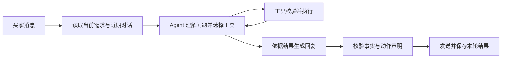

# 万达客服 Agent 修复方案

日期：2026-10-17。状态：分阶段实施中；FAQ 渠道隔离、统一上下文、工具观察与回复出口已部署。当前版本的 7,464 条独立案例重跑已完成，发现回归信号；连续会话状态回放、旧路径退场及流程版本迁移尚未完成。

## 1. 要达到的效果

买家发来不同说法时，系统围绕当前问题处理：理解需求，使用已知信息，缺项就具体追问，能查就调用工具，最后按结果回答。普通咨询不受无关订单状态干扰；涉及金额和订单动作时，由代码核验执行条件。

本次复用现有工具循环、需求版本、报价与订单存储。先在万达店铺落地，验证后再扩展其他渠道。

## 2. 当前问题与修复重点

当前代码已经有 Agent 循环和需求版本。Agent 启用时，多数旧关键词分支也已绕过，不能把所有问题归因于“所有旧路由同时运行”。已经确认的主要问题如下。

| 问题 | 当前位置 | 修复方向 |
|---|---|---|
| 普通问答也预先带入购票／付款核验信息 | `application/service.py::_answer_with_ai` | 默认提供当前需求和订单摘要；需要平台事实时再查询 |
| 意图登记成为每轮强制步骤，登记后又限制工具调用 | `buyer_assistant.py::record_buyer_intent`、`finalization_feedback` | 意图作为可修正的理解和日志；具体动作是否合法由工具验证 |
| 历史影院要靠模型主动查引用，容易遗漏 | `buyer_evidence.py`、`demand_context` | 每轮直接提供已保存需求和必要来源；有歧义再查询历史 |
| 工具结果格式、成功含义和失败恢复不一致 | `BuyerAssistantTools.execute`、`conversation_ai.py::_chat_with_tools` | 对外统一返回结构，明确缺信息、拒绝执行、结果未知和真实待办 |
| 回复包含“付款／改价”等字就可能触发整体替换 | `buyer_assistant.py::guard_reply` | 按动作及事实校验交易断言，保留取票说明等正常回答 |
| “稍等”的不同说法仍有漏判 | `reply_feedback` | 让等待承诺关联真实后续任务，避免仅靠措辞匹配 |
| 新旧行为分支和注释交叉，维护时难以确定入口 | `service.py`、提示词与工具说明 | 明确每种入口的责任；通过验收后移除已替代分支 |

上一轮全量筛查结果为：转人工 213 条，工具轮数达到上限 66 条，等待类措辞 9 条。二次模型复核标出 5 条疑似空等、20 条疑似意图／回复问题；这不是人工评定的错误率。

## 3. 分工与处理顺序

图片识别、平台付款事件、出票回调、二维码交付和发货继续由对应执行流程处理。它们给 Agent 提供事实，买家的自然语言不能代替平台付款或执行回执。

自然语言问答统一进入一个 Agent 循环。现有候选菜单的明确序号选择、配置里的精确操作指令先保留，逐项验证后再决定是否迁移。不能因为整理代码而直接删除仍有用户使用的指令。

同一条消息可以有多个目标，例如“四张多少钱，孩子要买票吗”：询价和儿童规则咨询均可处理，不强迫整句话只能属于一个意图枚举。

## 4. 上下文怎样保存和提供

每轮由代码装配一份明确的上下文，复用已有 `demand_id / demand_rev`、报价记录、订单记录和来源信息：

- 当前消息：本轮买家原话及消息标识。
- 当前购票需求：影院、影片、日期、时间、数量、位置要求、已知缺项和来源。
- 当前报价：属于哪版需求，是单价还是整单价，是否具备交易条件。
- 关联订单：各自绑定的需求／报价版本、付款状态与最近核验时间。
- 后续任务与交付：真实任务标识、处理状态、二维码发送和发货回执。
- 近期对话：保留能解释“这两个／今天／还是原来的”的消息及图片引用。

处理原则：

1. 已经保存的字段直接提供给 Agent，无需每轮重新从聊天里找。
2. “今天”只补日期；“三张”只补数量；模型不能顺带改其他字段。
3. 对未保存的历史信息，沿用可验证的字段来源引用。指代不明时问具体缺项。
4. 旧订单和新需求各自保留。新场次询价不能读旧订单金额作答案，也不能因此改掉旧订单。
5. 只有单价、数量未知时保持单价报价；数量明确后重新计算并生成对应版本的整单报价。
6. “中间会员座”是位置偏好，与已确定的排座号分别记录；默认偏好不能生成虚构座位。
7. 连续消息按会话串行处理并保存需求版本，防止后一条覆盖前一条。重复事件不得重复改价或建单。

不建立第二套平行的需求或订单数据库。上下文装配只读取现有权威记录；必要的消息来源与任务关联补到现有结构中。

## 5. 工具怎样整理

现有工具先通过适配层统一结果，再逐步合并重叠接口。保留的能力包括：读取需求、补充购票资料、查询影院／场次／价格、查询本店规则、查询平台订单、按有效报价申请改价、查询交付状态。

常用资料补充可以合并入口：影院、影片、日期、时间、数量、位置偏好按字段更新，内部调用已有校验和核价流程。涉及改价等交易动作的工具单独保留，不能混进通用“更新资料”工具。

统一的工具返回结构包含：

| 字段 | 含义 |
|---|---|
| `status` | 已完成、需要补充、条件不允许、结果未知、真实处理中、确定失败 |
| `summary` | 可以向买家解释的简明结果 |
| `facts` / `updated_fields` | 实际查询或更新的事实，包含来源 |
| `missing_fields` | 继续处理缺少什么 |
| `next_actions` | 当前允许执行的后续动作 |
| `quote_kind` | `UNIT_PRICE` / `ORDER_TOTAL`；单价不可用于交易 |
| `tradable` | 由代码按当前报价有效性、数量、座位及交易条件计算，模型不得自填 |
| `operation_id` | 已真实创建或确认存在的后续任务；没有则为空 |

模型选择何时调用工具；工具自己检查输入、身份、需求版本及执行前提。价格由核价代码计算；改价工具核验订单、当前有效报价引用、目标金额及平台待付款状态。

重复调用的缓存按“参数＋依赖的需求／订单版本”区分。参数错误允许纠正；外部写操作结果未知时，查询原操作结果，不重复提交。

“工具曾被调用”不能算完成。“等待付款”也不能当成已完成改价；必须有对应平台核验结果。

## 6. 回复怎样保证正常

将回复校验集中在一个出口，取代多处先后覆盖回复的做法。校验依据是本轮实际结果和回复中的事实／动作声明。

- 普通说明：例如如何使用二维码，使用本店规则和取票说明回答，不因订单不是待付款就整句替换。
- 缺信息：只问阻止下一步的字段。已知影院就不再问影院；“9:15”上午还是晚上不明时针对时间追问。
- 交易事实：价格、改价、付款、出票、退款、发货等声明引用相应工具结果。没有依据的声明退回修正，正常解释内容保留。
- 后续联系：只有已有真实任务，并且存在对应通知／跟进路径，才允许承诺有结果再通知。仅查到待出票状态时，可以解释该状态；不能由此随意承诺店家稍后回复。
- 转人工：明确转人工原因，并确认通知或待办实际创建。未创建成功时不得声称已通知。买家明确要求人工时尊重其要求。

模型最终输出除回答文字外，附带最少的结构信息：采用哪些事实、是否提出操作或后续承诺、关联哪个结果／任务。普通聊天无需声明交易事实；结构信息不是授权，代码仍核验引用是否存在、适用且最新。

结构声明也可能漏报，因此保留对金额、执行成功及后续承诺的检查作为防线；疑点可要求模型依据事实修正。不能只信模型自报“这不是交易回答”，也不能仅靠出现某个词就替换整段话。

无法恢复时使用当前任务对应的具体说明或问题，避免反复调用和统一的“没理解清楚”。轮数达到上限本身不自动等于需要人工；按剩余缺项和真实待办给出结果。

## 7. 店铺配置怎样分工

| 配置 | 应该写什么 |
|---|---|
| 店铺人设 | 店铺身份、经营范围、服务对象 |
| 回复风格 | 语气、称呼、篇幅 |
| 本店经验／业务规则 | 儿童票、会员座偏好、手续费、赠品等本店真实口径及适用范围 |
| 回复文案 | 报价卡、出票交付、转人工等事件触发的可编辑模板 |
| 功能设置 | 哪些功能允许自动执行、适用渠道及生效范围 |

同一业务规则确定一个配置来源，其他位置引用，避免人设、注意事项、本店经验和代码里各写一版。功能开关控制代码是否允许执行；提示词不能覆盖开关。

儿童票及默认中间会员座使用店主已确认的口径。影享卡回收、停车券、赠品、收费、确认收货等尚无确定口径的主题，列为待配置项；既不猜答案，也不制造“稍后回复”的任务。

## 8. 实施顺序与验收

| 阶段 | 工作 | 完成标准 |
|---|---|---|
| 0：校准基线与恢复查询 | 隔离运行当前测试；纠正良票测试误用万达夹具；修复 cityCode 空值缓存 | 保留万达缺桥阻断；如旧自检仍失败，逐套记录，不宣称全绿 |
| 1：固定问题与入口 | 复核 5 条空等、20 条意图疑点及 137 条新增筛查标签，记录真实入口、事实和期望行为 | 人工需求、资料缺失、误判断分别有证据；筛查标签不直接当标准答案 |
| 2：统一上下文与工具结果 | 装配当前需求／订单／来源；工具返回适配统一 | 连续消息合并成功；单价／整单价区分正确；失败不会变成成功 |
| 3：整理决策与回复出口 | 意图登记退为可修正元数据；集中回复校验；等待关联真实任务 | 领取方式不被付款文案覆盖；缺项具体追问；没有任务不能承诺后续联系 |
| 4：迁移旧路径 | 万达按店铺开关切换；验证完成后删除被替代分支和冲突说明 | 同一条自然语言消息只有一个问答入口；配置指令仍有明确执行路径 |
| 5：验证与发布 | 代表案例、连续会话、交易反向用例、全量回放和受控上线 | 达到下列验收条件；发布哈希、对比结果和回滚记录齐全 |

阶段 0 的实测基线（2026-10-17）：当前 `test_*.py` 为 500 项通过；旧 `run_checks.py` 注册 55 套，其中 29 套退出非零（包含超时），并非全部由缺桥导致。详情见 `release-preflight-baseline-20261017/baseline-results/`。现代测试通过不能抵消旧门禁失败；旧断言迁移必须有现行业务断言替代，不能删除检查换取通过。

渠道采用 B：已知万达缺桥、城市查询失败或映射未完成时保持阻断；良票用例使用非万达样本。C 会在缺桥时切换供应商，违背当前万达渠道约定，因此不采用。

按验证轮次安排：阶段 0 为“复现→最小修复→回归”至少一轮；阶段 1 为逐案例标注及复核一轮；阶段 2、3 各按上下文契约和回复契约独立一轮；阶段 4 先影子比较再切换验证；阶段 5 为全量回放一轮及异常补跑、复核一轮。每轮以证据齐全为结束条件，不能据此承诺固定小时数。阶段 0 的缓存修复可独立发布，但不表示统一入口或全量验收已经完成。

阶段依赖顺序固定。每阶段先验证再继续，避免把上下文改动、交易执行和提示词调整一次性混合发布。

### 必须验证的场景

| 场景 | 期望结果 |
|---|---|
| 先发影院，后发“2230的奥德赛 两人”，再补“今天” | 保存同一需求，确认当前日期，继续查场次；不重复问已知影院，不沿用旧订单价格 |
| “六排四张多少钱／四个人呢／如果买四张合计多少” | 理解询价与购买确认的区别；查询或计算正确参考价格，不误改原订单 |
| “三张”后又说“不是，四张” | 更新同一需求版本；报价与数量一致，旧报价不被继续执行 |
| 已有旧订单，发新场次截图 | 新需求与旧订单独立；明确替换后才申请更新原待付款订单 |
| “怎么还没改价” | 查平台；符合条件才申请，核验一致后才说已改好 |
| 已付款／多订单／操作结果未知 | 说明实际状态并执行允许的查询或澄清，不重复改价或下单 |
| “这个怎么领取／扫码在哪里” | 回答二维码使用方式；需要交付查询时读交付记录 |
| “这两个／中间的”配图 | 能确定才保存具体位置；不明确就问具体区域，不虚构座位 |
| “OK／谢谢／收到” | 简短收尾；不恢复旧任务 |
| 规则没有配置 | 说明该项尚未确认；需要人工时创建真实通知，不能空口承诺跟进 |

### 验收门槛

1. 已确认的问题案例及其多种问法通过；负向检查必须断言没有误改价、重复建单或无依据成功声明。
2. 新增连续会话回放：实际把上一轮保存的状态传给下一轮，覆盖图片后补文字、数量修改、换场次、旧订单和交付后收尾。
3. 原 7,464 条完整重跑，用相同 ID、冻结代码／配置及真实工具执行记录比较；网络异常单独补跑，不用旧结果填充缺失。
4. 转人工、等待和轮数上限全部复核，同时检查此次已出现的 137 条新增筛查项，防止只看总数下降。
5. 对普通回复做分层抽查：按店铺、时间、是否有图片／订单、单轮／连续对话覆盖，查找没有触发筛查标签的答非所问；抽查不冒充全量正确率。
6. 历史资料缺失的案例保留未知；用明确标注的隔离夹具补测成功路径与禁止执行路径，不伪造历史响应。
7. 关键交易用例不得出现错误动作；任何已确认的高风险问题都阻止发布。已确认的可恢复普通咨询不能统一转人工或泛化兜底。
8. 不承诺任意自然语言 100% 正确；发布报告列出仍未解决的具体问题和依据，不能只给一个通过总数。

## 9. 发布和回滚

增加一个按店铺生效的迁移开关，先在隔离环境和不发送买家消息的影子验证中比较新旧结果。影子路径使用只读或模拟执行器，不允许真实改价、建单或发货。

验证通过后在万达店铺小范围启用。对正在处理的会话固定流程版本，避免同一需求处理中途混用新旧行为；发布前核验线上基线，备份变更文件并记录哈希。观察接口失败、未回复、重复执行和人工通知是否实际送达。

会话迁移细则（以下为阶段 4 待实现契约，当前尚未启用迁移开关）：

- 为持久会话、需求及操作记录保存 `flow_version`。旧会话缺字段时显式归入 legacy，重启不能自动升级。
- 有有效报价、待付款、已付款待出票、退款、未知结果或未完成命令时，原需求固定原流程版本直至完成；切换店铺开关不迁移这些操作。
- 新会话或旧需求结束后的独立新需求才选择新版本；历史订单保持原需求与版本绑定，不因新询价而覆盖。
- 工具引用校验 `flow_version + demand_id + demand_rev + quote_id`，操作及任务保存相同引用。旧操作恢复沿用原幂等标识，不跨版本重放。
- 回滚只停止新增新版本任务，进行中操作先查原结果；不能把同一笔操作交给另一流程再次提交。

出现交易校验异常立即关闭新入口。已开始的交易通过原操作标识核对恢复，不因切回旧入口重放；不得把报价／订单数据回滚成旧版本来掩盖已发生的操作。

## 10. 交付物

- 实际生效入口图与职责表，标明保留、迁移和删除的分支。
- 上下文、工具返回、回复校验的明确契约。
- 问题案例、多问法、连续会话和交易反向验证结果。
- 同一 7,464 个 ID 的新旧对比、残留问题、线上发布与回滚证据。

实施优先级是：**先统一上下文和工具结果，再整理回复校验，最后删除已替代的旧路径。** 这能使普通理解归 Agent、业务事实归权威记录、执行条件归工具校验，各自有明确责任。

## 补充：报价金额异常优先处理

2026-10-17 只读核查买家 vikidream（408703604）发现：截图座位价38元，插件保存的万达渠道成本为40.90元（当时原始接口返回未留存，尚未独立核实），未命中规则后按该值报出40.90元，并显示“原价40元／优惠后40.90元”引导拍下。用户纠正后直接查今天多个场次，均为38元；同账号只读核价也得到38元。40.90进入原报价的来源尚未查实。完整证据见 [调查记录](../audits/vikidream-pricing-20261017.md)。

这属于报价执行层缺口，排在普通回复重构之前处理。必须先补价格来源追踪并定位4090的进入点，不能以“未命中规则”冒充完整根因：

1. 核对万达通道规则的品牌范围，覆盖明确支持的寰映等影院；保留真实品牌，不伪造识别结果。
2. 将截图实际价和接口挂牌价分别保存，选择可信、同场次同座位的买家可比价格。
3. 两条渠道在输出可交易报价前共用比价检查；没有价格优势时说明并提示自购，不把更高售价写成“优惠后”。
4. 持久记录成本区域及会员价／普通售价来源，报价规则版本和比价依据。
5. 加入“38元截图、40.90元成本、两张”和混合分区等反向用例；不能靠把售价压到成本以下来消除异常。

12:16重测补充确认：红薯麻麻的14:20场售价38元，但原价40元取自良票识图补全的 `originalPriceFen=4000`，该次截图价格本身未识别到。需停止将不同渠道的价格无标注混成“原价／优惠后”，不能把截图缺价格自动解释成接口40元就是买家自购价。详见 [来源记录](../audits/quote-original-price-20261017-1216.md)。

## 实施记录：FAQ 渠道隔离（2026-10-17）

已完成 FAQ 在 Agent 工具、无模型关键词回复及嵌套引用之间的渠道一致性修复，覆盖旧配置和编辑后重载。当前行为测试入口已上线，线上独立副本 529 项通过。详细证据见 [本次修复报告](../audits/faq-channel-repair-20261017.md)。这属于入口与事实来源的局部修复，不代表阶段 2/3 架构整理或旧门禁迁移已经完成。

## 实施记录：统一上下文、工具观察与回复出口（2026-10-17）

已在原 Agent 中接入 `assistant_context`、`tool_observation`、`assistant_reply`；模型循环和发送边界复用同一核验策略。普通说明可直接返回结构化答复，无须额外登记意图；交易动作仍按原有工具约束登记并核验。历史订单不能证明新需求的付款、出票状态；同轮工具更新报价后，回复金额核验读取当前报价，不继续使用初始快照。

本地与线上隔离副本均通过 561 项当前行为测试。发布 9 个文件，逐文件 SHA256 核对，服务健康检查 HTTP 200。阶段 2/3 已完成本轮兼容接入，尚未宣称全部完成：流程版本迁移、剩余旧分支删除、真实模型连续回放和 7,464 条全量重跑仍待执行。详见 [实施报告](../audits/agent-context-repair-20261017.md)。

### 回复观测补充

已部署 NEEDS_REPAIR、invalid_response_metadata、缺少信封和最终降级计数，候选答复及会话轮次分别作分母。新回放结果可导出相同指标，未观测的旧结果不计为零错误。本地和线上隔离验证 566 项通过；7,464 条尚未重跑，暂不报告新的真实发生率。详见 [观测口径及证据](../audits/reply-observability-20261017.md)。

## 最新验收：当前版本 7,464 条独立回放

观测补充后的本轮已重跑相同 7,464 个 ID，保留 7,733 条尝试，最终均取得结果。转人工 213→361、达到轮数阈值 66→266、泛化不理解兜底 17→251；等待措辞 9→7。候选修正率 47.94%，最终兜底／规则投影率 35.13%；这些不是线上错误率，也不能把工具失败或缺证投影全部归为 JSON 问题。

本次出现回归信号，不能凭 566 项单测或代码分层就宣称架构改动改善了真实模型效果。下一步优先核查普通问答的结束条件，并记录逐轮候选与拒绝原因，再验证修订；不继续按单个问法补正则。详见 [本轮检查报告及全部案例](../audits/conversation-replay-20261017-context-v1/检查报告.md)。本轮未修改线上业务代码、未执行买家订单或消息发送。

## 后续修复：失败收敛、回复契约和未匹配影院恢复

2026-10-17 已发布：完成判定区分“未尝试”和“尝试失败”；失败查询不会继续被要求重复相同动作，仍不得声称交易成功。最终回复契约统一要求 JSON，并给普通说明和真实事实引用示例；格式修正最多 2 次，业务工具预算独立保留 10 轮，最后文字回复仍核验。

marco5756 的图片已识别出厦门鹭港广场店及 18:25，但上游没有匹配影院 ID。旧恢复入口以名字含“万达”作为前提，错误跳过只读映射；现已允许无品牌字样的完整 OCR 事实走只读匹配，保留同名、同城及唯一影片场次校验。店主清空的万达识别提示，也不再因渠道未知回落全局而重新发出。该图已在线只读核验 EXACT，未重放买家事件或发送消息。

本地与线上隔离当前行为门禁均 592 passed。相同 7,464 个 ID 的新对照回放已冻结源码配置并启动，当前尚未完成，不报告改善比例。新报告把 `model_calls>=10`（高调用次数）与真正 `ROUND_LIMIT` 分开统计；原先 266 是前者，不能当成工具预算耗尽次数。详见 [本单修复证据](../audits/marco5756-20261017/修复报告.md) 和 [新回放方法](../audits/conversation-replay-20261017-convergence-v2/方法与范围.md)。
