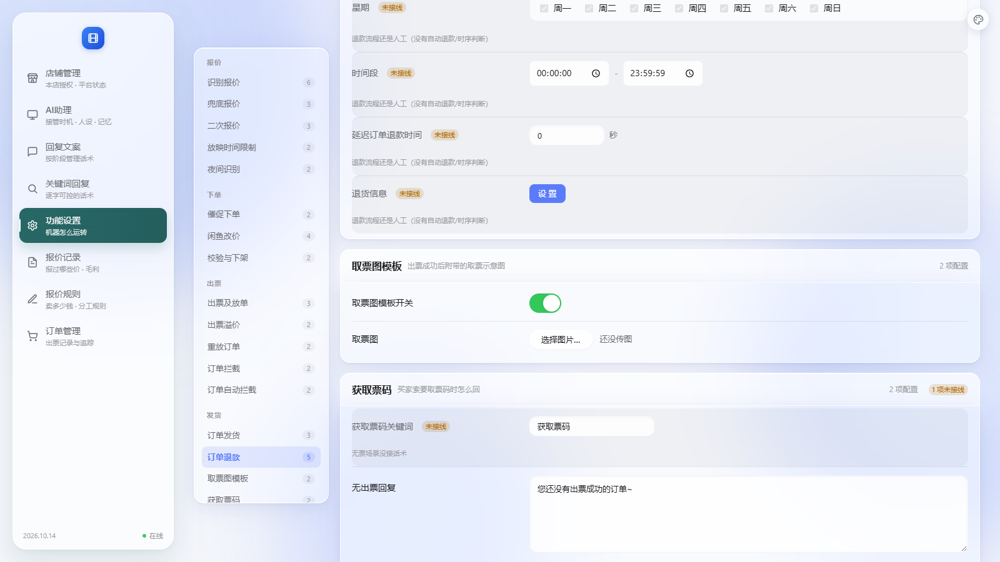

# 接线：取票图收尾（上传控件 + 分层修正）

> 日期：2026-10-14
> 店主：「继续」
> 上一轮取票图的后端做完了，但**店主没地方传图**。这轮补上控件，
> 并在过程中发现自己的分层错误（循环依赖 1 → 3）修回去。



---

## 一、上一轮留的坑：店主没地方传图

后端早就 `store_upload()` 了，但界面上没有控件 ⇒ **功能等于没用**。

### 做了什么

```
① settings.C.IMAGE        新控件类型
② TicketImageTemplate.template  control=RADIO → control=IMAGE
③ web/config.js 的 RENDERERS.image  选图 → FileReader → base64 → 隐藏字段
④ web/config.css  .img-pick/.img-note/.img-cur（全用令牌，无字面颜色）
⑤ /api/settings 保存时【把图截出来】存进 data/ticket-image.json
   settings.json 里那个字段保持空 —— 图不该进配置文件
⑥ /api/settings 读取时带出 ticket_image 状态（有没有图/多大/传没传过）
```

**实测**：
```
保存返回 ok=True，ticket_image_error=''
/api/settings → {'has_image': True, 'kind': 'image/png', 'bytes': 308, 'uploaded': False}
settings.json 里的 template = '模板1'  ← 保持干净
ticket-image.json 的键 = ['bytes','data','kind','name']  ← 图在这里
界面：无"未接线"徽章、「选择图片…」+「还没传图」正常
```

---

## 二、★ 修一个我自己埋的坑：data URL 前缀

**`store_upload` 第一版直接 `base64.b64decode(s, validate=True)`。**

**而真实浏览器 `FileReader.readAsDataURL()` 给的是**：
```
data:image/png;base64,iVBORw0KGgo...
```
**带前缀 ⇒ 必然解码失败。** 我实测确认了（返回"不是合法的 base64"）。

**⇒ 修**：在后端**剥掉前缀**，而不是要求前端记得剥 ——
前端总有一天会忘，后端剥一次就永久安全。

**★ 这类 bug 最典型的特征**：单元测试用干净的 base64 全过，
**只有真的从浏览器上传才会炸**。我是靠"模拟前端真实给法"才抓到。

---

## 三、★★ 循环依赖 1 → 3，然后修回 1

### 我干了什么

```
上一轮：架构审计报「孤儿模块 ticket_image」（我在函数内动态 import）
⇒ 我改成模块级 import（ticket_image 为了取 plugin_secret 而 import plugin_api）
⇒ 循环依赖从 1 涨到 3：
     plugin_api → plugin_runtime → plugin_api                （原有的）
     plugin_api → plugin_runtime → ticket_flow → plugin_api   ← 我引入的
     plugin_api → plugin_runtime → service → ticket_flow → plugin_api  ← 我引入的
```

### 根因：**领域层干了接线层的活**

`ticket_flow` 里我写了 `_api.queue().enqueue(_c)`：
```
ticket_flow 是【领域层】，queue 是【接线层】的东西。
它一 import plugin_api，而 plugin_api 自己依赖 plugin_runtime，
plugin_runtime 又依赖 service → ticket_flow ⇒ 必然成环。
```

### 正确修法：**把"排队"这个动作搬到外层**

```python
# ticket_flow（领域层）：只造命令，挂到结果上
out.pending_commands.append(_c)

# plugin_runtime（外层）：统一入队
for _pc in (getattr(result, "pending_commands", None) or []):
    commands.append(_pc)
```

**★ 顺带解决了密钥的问题**：用**依赖注入**。
```
ticket_image（内层）:  _secret_provider()   ← 调用注入进来的函数
plugin_runtime（外层）: _ti.set_secret_provider(plugin_secret)  ← 启动时注入
```
依赖方向只有**外层 → 内层**，内层不 import 任何 application 模块。

**★ 为什么不能用"调用方传参"**（我第一版的做法）：
`ticket_flow` 为了拿到密钥还是得 `from application.plugin_api import plugin_secret`
—— 环还在。**注入才是解法。**

### 结果
```
循环依赖：3 → 1（只剩原来就有的 plugin_api ↔ plugin_runtime）
孤儿模块：0
分层违规：0
```

---

## 四、★ 这轮学到的两条

```
① 报错说"孤儿模块"时，不要【为了消警告而加 import】——
   要先问"这个模块该被谁用、依赖方向对不对"。
   我为了消一个警告，引入了两个循环依赖，而且全量自检还报"全部通过"
   （循环那条在别的套里，我是单独跑架构审计才看见的）。

② 领域层不许 import 接线层。判据很简单：
   如果一个模块 import 之后出现了环，那多半是【它干了不属于它这一层的事】——
   ticket_flow 该"造命令"，不该"排队"。
```

---

## 五、状态

```
✅ 取票图上传控件（选图 → base64 → 存单独文件 → 界面显示状态）
✅ data URL 前缀在后端剥掉（浏览器真实给法）
✅ C.IMAGE 控件类型（可复用给别的图片设置）
✅ 注册表 58 → 33
✅ 循环依赖修回 1（只剩原有的）｜孤儿模块 0｜分层违规 0
✅ 新增 4 条断言（含"领域层不直接排队"、"不 import plugin_api"）
✅ 35 套自检全过（45.3 秒）｜ _check_ticket_flow 186 项
```

**取票图现在真的能用了**：
```
店主传图 → 开开关 → 出票成功 → 自动上传到平台（拿 alicdn URL）
                              → 附一条带图的发给买家（同一单只发一次）
```

**⬜ 剩下 33 项**（和上轮一样分两类）：
```
要定语义的   fallback_quote.mode / price_capped、second_quote.*、
           ticket_release.mode / ticket_premium.*、
           order_intercept.* / order_auto_intercept.*、get_ticket_code.keyword
要设计的     order_refund 时序（weekdays/时段/延迟/退货信息）、
           manual 超时关闭、greeting、night_recognize、blacklist、reorder
```

**下一轮建议做「退款时序」**（`order_refund` 的 4 项 + 可能带动 `manual` 2 项）——
它是纯定时任务，和已经做完的提醒引擎同一个形状，能复用那套机制。
