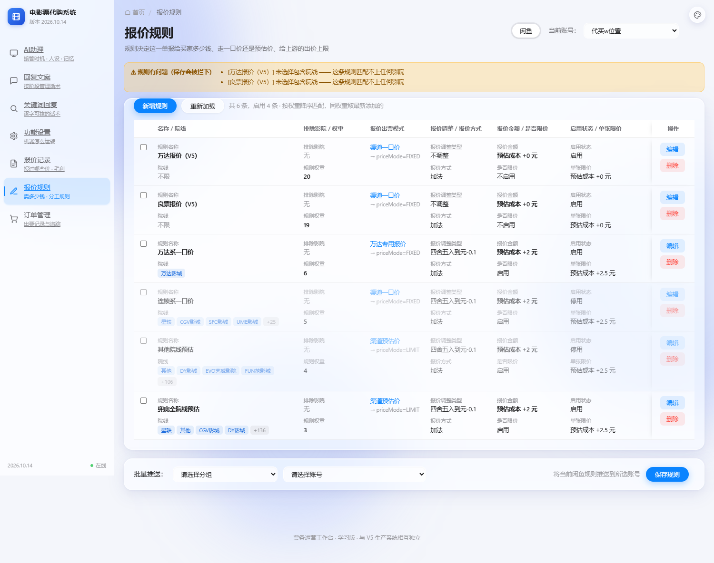

# 改造：V5 两条报价规则落地 + 设置页审计 + UI 修复

> 日期：2026-10-14
> 店主这一轮提了 7 件事，本文逐条记结果。

---

## 一、★★★ 最重要：V5 的万达/良票报价规则已落地并启用

### 1.1 V5 在哪、规则存在哪（子代理全盘搜的结果）

```
V5 生产快照   E:\200行的agent\v5-prod-9bee216
              （_prodmeta\deployment-manifest.json: build 20260913-233215）
V5 开发主仓   E:\鱼麦多\v5（唯一带前端源码：frontend\src\pricing-rules.jsx）
线上真实库    ubuntu@124.220.29.179:/var/lib/ticket-system-v5/business-settings.sqlite3
本地只读副本  E:\200行的agent\.shadow-data\business-settings.sqlite3（revision=52）
只读快照      E:\200行的agent\生产配置-20261009.md
★ D 盘没有 V5（搜过根目录 + depth2/4）
```

**规则不在代码里写死**，在 `business-settings.sqlite3` 的 `business_settings` 表：
```sql
CREATE TABLE business_settings (key TEXT PRIMARY KEY, value TEXT NOT NULL,
                                updated_at TEXT NOT NULL, revision INTEGER NOT NULL)
```
key = `wanda_pricing` / `liangpiao_pricing`，由 `domain/quote/pricing.py` 读取计算。

### 1.2 两条规则的内容（三个独立来源一致）

**万达报价** — `basis = fixed_per_ticket`（每张固定加价）
| lower_bps | upper_bps | adjustment_bps | fixed_add_fen | upper_inclusive |
|---|---|---|---|---|
| 0 | 5000 | 0 | **100** | false |
| 5000 | 6000 | 0 | **100** | false |
| 6000 | 7000 | 0 | **100** | false |
| 7000 | 8000 | 0 | **100** | false |
| 8000 | 9000 | 0 | **100** | false |
| 9000 | 10000 | 0 | **100** | true |

→ 报价 = 官方优惠价 + 1 元/张，取整到 1 角（`rounding_fen=10`）

**良票报价** — `basis = estimated`（按折扣率加价）
| lower_bps | upper_bps | adjustment_bps | fixed_add_fen | upper_inclusive |
|---|---|---|---|---|
| 0 | 5000 | **1000** | 0 | false |
| 5000 | 6000 | **800** | 0 | false |
| 6000 | 7000 | **600** | 0 | false |
| 7000 | 8000 | **400** | 0 | false |
| 8000 | 9000 | **300** | 0 | false |
| 9000 | 10000 | **100** | 0 | true |

→ 折扣率 <50% → +10%、50-60% → +8%、60-70% → +6%、
   70-80% → +4%、80-90% → +3%、90-100% → +1%
→ 报价 = 供应商基础价 ×(1 + 比例)

### 1.3 我们这边的实现状态

```
✅ domain/quote_rules.py 的 price_by_tier 早就"逐字对齐 V5 pricing.py:71-106"
   —— 连 BASIS_PER_TICKET（每张固定加价）那个分支都还原了。
   所以这次【不用改算法】，只要把两条规则的数据落进来。
✅ QuoteRule 的字段与 V5 的 PricingRule/PricingTier 完全一致
   （lower_bps/upper_bps/adjustment_bps/fixed_add_fen/upper_inclusive）
```

### 1.4 ★ 新增 `channel` 字段（这次的关键设计）

```
问题：V5 这两条是【按渠道】的 —— 同一家影院走万达 +1 元/张、
      走良票按折扣率加价，跟"哪个院线"无关。
      而我们的规则只按 brands（院线）匹配，表达不了这件事。

做法：QuoteRule.channel，取值 CHANNEL_WANDA / CHANNEL_LIANGPIAO / ""（空 = 不限）
      · find_rule(channel=...) 过滤：规则有 channel 就必须相等才命中
      · channel="" 的调用方只看到 channel="" 的规则 → 老行为一点不变
      · 权重 20/19 压过原来的 6/5/4/3（渠道口径比院线口径更具体，先命中）
```

### 1.5 ★★★ 我在这上面踩的四个坑（都留了记录）

**坑 1：加错了函数 —— 加了等于没加**
```
我先把两条规则加进 tianjin_default_rules()，
但那个函数的文档明写「用于对照结构，不是可直接用的配置」，
真正生效的是 seed_rules()。
⇒ /api/rules 一直返回旧那 4 条，我那两条根本没生效。
  发现方式：查 /api/rules 的实际返回，而不是"我改了代码"。
```

**坑 2：`adjust` 用错，把加的 1 元又减掉了**
```
V5 的取整靠 rounding_fen=10（到角）。我错用了「四舍五入到元-0.1」：
    成本 3140 + 100 = 3240 → 取到元 3200 → 减 0.1 元 = 3190  ✗
正确（到角）：3240 → 3240 ✓
★ 两个名字里都有"0.1"，极易混：
    「到元-0.1」= 先到整元再减一角（6435 → 6400-10 = 6390）
    「到角」    = 直接到角（6435 → 6440）
```

**坑 3：折扣率的两个口径混用 —— 这是真 bug**
```
原代码：disc = discount_bps_of(p["base_fen"], original_total)
对 fixed_per_ticket 来说 p["base_fen"] 是【单张】成本，
而 original_total 是【整单】原价 —— 两个口径不一致，比值就是错的。

实测（成本 6280 / 原价 7180，2 张）：
    错：单张 3140 ÷ 整单 7180 = 43.73%   ← 日志里显示的就是这个
    对：整单 6280 ÷ 整单 7180 = 87.47%

⇒ 两个后果：
   ① 日志/界面显示的折扣率是错的，运营据此判断会误判
   ② 档位选择也用错基数（pick_tier 同一个 bug）——
      万达那 6 档 fixed_add_fen 恰好全等，所以金额没暴露；
      一旦各档不同（就像良票那条），就会选错档 → 报错价
★ 修复：折扣率一律【整单成本 ÷ 整单原价】；
  original basis 是例外（它的基数本来就是原价 → 恒 100%），显式写出来。
```

**坑 4：取整做了两次**
```
price_by_tier 内部已经按 rounding_fen=10 取整（6470），
外面 quote() 又套了一次 _adjust(unit, rule.adjust)。
若 adjust=到角：6470 → 6480，把良票 +3% 算出来的价又抬了一角。
⇒ V5 两条的 adjust 必须是「不调整」（ADJUST_NONE）。
```

### 1.6 验证结果（逐项对 V5 口径）

```
万达渠道（期望 = 每张成本 + 100 分，取整到角）：
  3140×2 → 6480 ✓      4500×1 → 4600 ✓      4500×4 → 18400 ✓
  4500×1 → 4600 与 V5 实测记录 4500→4600 完全吻合 ✓
  （另有 2990×2 被原价封顶压到 6000 —— 这是"不许卖超官方原价"的正确行为）

良票渠道（期望 = 成本×(1+档位比例)，取整到角）：
  40% → +10% → 4400 ✓    55% → +8%  → 5940 ✓
  65% → +6%  → 6890 ✓    75% → +4%  → 7800 ✓
  85% → +3%  → 8760 ✓    95% → +1%  → 9600 ✓

渠道隔离（不传 channel 时不能被命中）：
  不传 channel → 命中"兜底全院线预估" ✓（不是渠道规则）
  传 WANDA     → 命中"万达报价（V5）" ✓
  传 LIANGPIAO → 命中"良票报价（V5）" ✓

存取往返：save → load 后 channel 与 6 档分档表都完好 ✓
```

### 1.7 ★ 配套修的界面（不修就有"保存丢字段"的隐患）

```
① 校验器不认识 channel → V5 两条被判"匹配不上任何影院"，保存被拦下
   修：domain/quote_rules.py validate_rule + web/rules.js 都加豁免
② 表单没有"生效渠道"字段 → collectForm 不收 channel
   ⇒ 从界面改任何一条再保存，channel 就被丢掉，
     规则静默退化成"按院线匹配但院线为空"，永远命中不了
   修：rules.html 加下拉 + rules.js 收集与回填
③ 分档表被藏起来、预览说假话
   methodNeedsTiers() 只看 method === '动态折扣'，
   而后端是「有分档表就用分档」⇒ V5 两条（method=加法）被当成"不用分档"：
     · 分档表藏了（用户看不到那 6 档）
     · 报价金额/单张限价行反而显示
     · 预览说"报给买家 预估成本 + 0 元"，实际是 +1 元/张
   修：判据改成「按每张固定加价 OR 方式要分档 OR 表里已有行」
④ 预览不分口径，一律说"按比例加减"
   而 basis=fixed_per_ticket 是【每张固定加钱】，跟比例无关
   修：按 basis 分四种说法
```

### 1.8 现在的规则页



```
w=20  启用  万达报价（V5）    渠道=WANDA      6 档
w=19  启用  良票报价（V5）    渠道=LIANGPIAO  6 档
w=6   启用  万达系一口价       渠道=不限（原有）
w=5   停用  连锁系一口价
w=4   停用  其他院线预估
w=3   启用  兜底全院线预估
```

---

## 二、★★★ 设置页审计：63 个控件里 39 个业务代码根本不读

### 2.1 判据（不是"文件里出现过就算用了"）

```
① 从 /api/settings 取【设置页实际展示】的控件（63 个）
② 在 application/ domain/ integrations/ server.py 里搜这个 key
   ★ 排除 settings.py 自己（它只管校验与渲染，不算"业务读了"）
   ★ 排除 tests / demos
③ 一个都搜不到 → 界面上有这个开关，但改了没用
```

### 2.2 结果

| 分组 | 摆设 | 总数 |
|---|---|---|
| 报价 | **10** | 16 |
| 下单 | **6** | 8 |
| 出票 | **6** | 11 |
| 发货 | **9** | 12 |
| 提醒 | **3** | 7 |
| 互动 | **5** | 9 |
| **合计** | **39** | **63** |

**典型（店主关心过的）：**
```
verify_amount「校验金额」   界面能关，代码里【恒定严格校验】
                            （恰好符合店主的要求，所以一直没人发现）
allow_seat_change「换座状态」settings 里定义了，但调 ch5_create 时【压根没传】
                            （api.py:269/312 出现的同名值是【接口形参】不是配置）
auto_reprice「自动改价」    只出现在 settings.py：定义 + 渲染 + 校验，业务零读取
auto_ship「自动发货」       同上
cap_yuan「溢价上限」        同上
```

**为什么这比"没这个开关"更糟**：
```
开着 ⇒ 用户以为生效 ⇒ 出问题时不会去查它 ⇒ 变成"玄学故障"
```

**⚠ 这一项我只做了审计，还没动手改。** 要店主定：**删掉**还是**逐个接上业务**。

---

## 三、★★★ 改价链是断的（比设置摆设严重）

店主定过「改价 = 选 C：先拍下、拍下后改价」。查整条链：

```
✓ 买家拍下 → AWAIT_REPRICE → 发 bubble 17「我改价后，您再付款」
✓ 状态机有 AWAIT_REPRICE + order.repriced → AWAIT_PAY → bubble 18
✓ SIDE_EFFECTS[order.repriced] = "REPRICE" → 落成 CHANGE_ORDER_PRICE 命令
✓ 插件端 executeReprice 完整（闸门/授权/读回验证/重试）

★★★ 但 Event.ORDER_REPRICED【没有任何生产者】：
    全仓只有 domain/conversation.py 的定义 + 演示脚本 + 冒烟测试手动推，
    应用代码一处都没有。
```

**后果**：买家收到"我改价后你再付款"→ 等着 → **从来没人调 changePrice** → 价格没改 → bubble 18 永远发不出去。

**插件的现状（查过）**：**没有** `fish.reprice.success` 这类可订阅事件。
改价是下行命令（我们发 → 插件调 changePrice → 回执行结果）。

**三条可选路线，要店主定：**
```
A：等插件回投的改价执行结果（reprice.mjs 结果里已带 price_after_fen）
B：不追改价结果，等 order.paid 用 detail.payment 反查
   （严格金额校验已经在做，付错会走 AMOUNT_MISMATCH）
C：两条都接（结果到了提前推 AWAIT_PAY，没到就等付款）
```

**⚠ 这一项也还没动手。** 等店主选路线。

---

## 四、UI 修复（店主：「这些 UI 都优化一下，再检查其他地方」）

### 4.1 删掉非闲鱼平台

```
index.html / config.html：淘宝、微信（disabled 展示项）→ 删
rules.html：淘宝、微信、拼多多、得物 → 删（这页居然有拼多多和得物，
                                          和店主给的清单一致）
★ 保留 .plat-tabs 容器不删：它是布局的一部分（和"当前账号"并排），
  删了标题会贴到右边；以后接第二个平台时容器还在。
★ 每个页面实测确认：平台项只剩 ['闲鱼']
```

### 4.2 报价规则表：列宽失控导致竖排 + 操作列被截断

```
症结：列宽合计 40+300+140+132+138+148+148+148+78 = 1272px
      而容器可用宽只有约 1180px ⇒ 整表被推出视口，最右的"编辑/删除"被截断
根因2：.rt-key 固定 width:92px，把 138px 的列挤到只剩 38px 给值
       ⇒ 「四舍五入到元-0.1」12 个汉字被挤成一个字一行

修：
① 键值改成【上下两行】（key 做小标签，值占整列宽）
② 去掉「生效时间段」列 —— 实测 4 条规则的时段【全部】是
   00:00:00-23:59:59（全天），148px 纯浪费。
   非全天规则改到「启用状态」列里多显示一行小字，信息不丢。
③ 列宽重算：合计 1124px，min-width 1320 → 1114
④ 操作列从两个裸文字链接改成两个居中带底色的小按钮
实测：scrollWidth = clientWidth = 1178，不再溢出 ✓
```

### 4.3 关键词回复页：颜色全是深色模式的 + 长回复静默截断

```
症结1：qa.css 的颜色【全部是深色模式的硬编码值】——
   .qa-keyword color:#69b1ff （深色专用亮蓝）
   .qa-ref     color:#d3adf7 （深色专用亮紫）
   .qa-badge   color:#5cdbd3 （亮青）
   var(--text, #e6e6e6)      （兜底是深色模式的浅色文字）
   而主题是【浅色底】(#f4f6fb) ⇒ 亮蓝/亮紫在上面几乎看不清
   （店主截图里那一片"淡得看不见的字"就是它）

症结2：.qa-content 有 max-height:96px + overflow:hidden
   ⇒ 长回复被【静默截断】，用户看不到全文也不知道被截了

修：整份 qa.css 重写（颜色走主题变量 + 深色模式单独覆盖）；
    .qa-content 改成"默认收起 5 行 + 点【展开看全】"，
    按钮只在【真的超行】时才由 JS 插入（短内容不会多个没用的按钮）
实测：25 行、4 条长回复拿到展开按钮、关键字色 = rgb(10,132,255) ✓
```

### 4.4 统一按钮风格

```
原来混着三种：↑↓ 是浏览器默认灰色小方框、「编辑」是 .btn-primary、
             报价规则页又是裸文字链接
⇒ 补上 .btn-ghost / .btn-primary 定义（style.css 里本来【没有】这两个类）
   .btn-ghost  26×26 方形、无底色、hover 才显形（次要动作）
   .btn-primary 淡蓝实心圆角（主要动作）
```

### 4.5 全站 UI 审计脚本（找同类问题）

```
四个判据：
  ① 浅色区里写死的深色模式颜色（按 @@media dark 块范围判断）
  ② var(--x, 兜底) 的兜底值是深色模式的值
  ③ 表格 min-width 与列宽合计对不上（必然横向溢出）
  ④ overflow:hidden 配 max-height（内容静默截断）
结果：唯一的真问题就是 qa.css（已修）；
      .rt-tags 的截断是故意的（旁边有 +N 折叠标记）
```

---

## 五、回答店主的问题：订单管理 / 报价记录存在哪

```
现在是 SQLite 文件，不是"数据库服务"：
  data/orders.sqlite3        订单
  data/orders.sqlite3        报价记录在 data/quotes.sqlite3
  data/plugin-queue.sqlite3  插件命令队列
（报价记录页底部那行"存储：E:\...\data\quotes.sqlite3"就是它）

★ 这是刻意选择：单店单机、零运维、备份 = 拷文件。
★ 插件上传到服务器后：文件跟着项目走，在服务器上的 ticket-agent/data/ 下。
★ 要换真正的数据库（MySQL/PostgreSQL）也可以 ——
  但要你明确要不要，因为会引入装机/备份/连接池的运维。
```

---

## 六、这一轮的状态

```
✅ 已做完：V5 两条规则落地+启用+验证 | 平台只留闲鱼 | 报价规则表修复
          | 关键词页修复 | 按钮统一 | 全站 UI 审计
⚠ 审计出但未动：设置页 39 个摆设控件（等你定删/接）
⚠ 查出但未动：改价链缺生产者（等你选 A/B/C 路线）
⬜ 未开始：店铺管理页（鱼麦多 GET /shops 已确认可用）| 推送机制
          | 加规则时选院线 + 点名字即增删
33 套自检全过（52.8 秒）
```

**待店主定：**
1. **改价链走 A / B / C 哪条**（第三节）
2. **39 个摆设控件：删掉还是逐个接上业务**
3. **推送机制的语义**（推什么给谁）
4. 报价规则页：加规则时选院线 + 点名字即增删 —— 现在做吗
