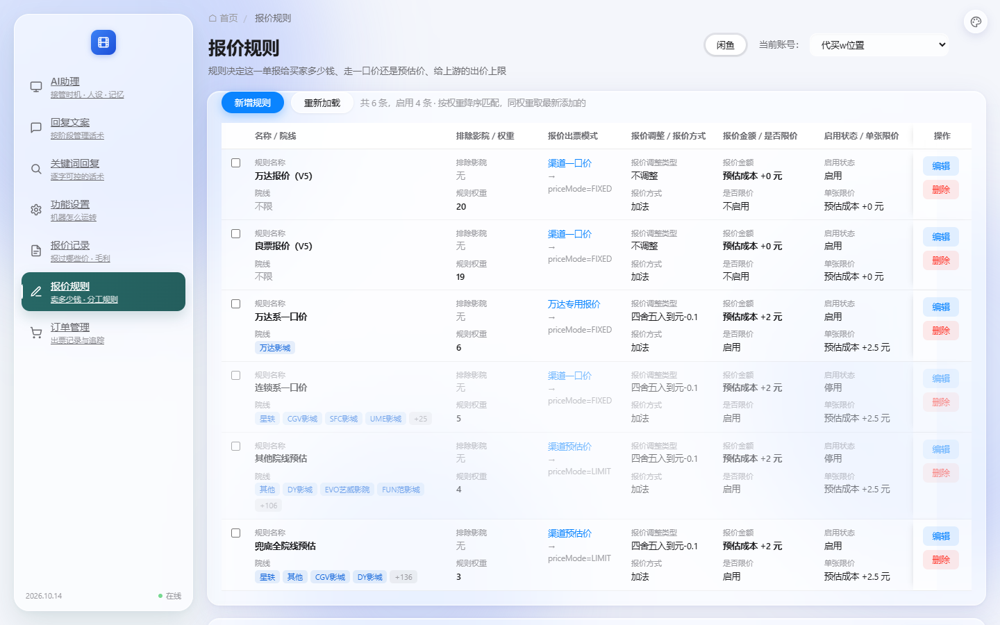
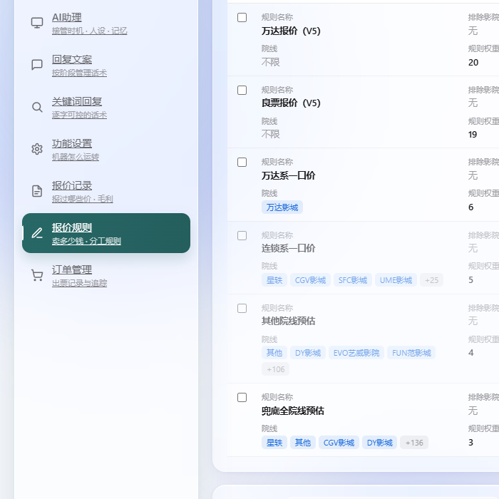
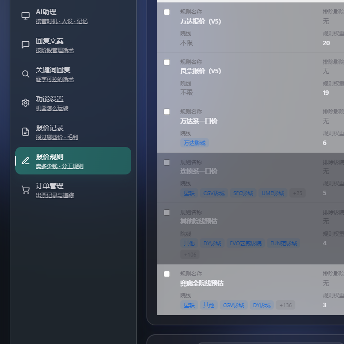

# 改造：侧栏改「悬浮玻璃岛」

> 日期：2026-10-14
> 店主给了完整规格文档，要求把侧栏从「贴左边缘通到底」改成悬浮玻璃岛。
> 另两条：**下划线还在**、**顶部不要显示「电影票代购系统」**。



---

## 一、那两条下划线（我上次删错了地方）

```
上次我删的是 .ticket-sidebar-foot 的 border-top（底栏）
店主指的其实是 .ticket-sidebar-brand 的 border-bottom（品牌区下面那条）
⇒ 两个位置都有线，删一个另一个还在。
现在两处都是 0，深色模式那两条 border-color 也一并对齐了。
★ 教训：店主说"某某地方的线"时，要按【视觉位置】去找，
  不能只在脑海里找一个"应该在那里"的规则。
```

## 二、顶部不显示系统名

```
去掉：<div class="brand-name">电影票代购系统</div>
      <div class="brand-ver">版本 2026.10.14</div>
保留：品牌图标（渐蓝圆角方块）—— 它是视觉锚点，整块拿掉会显得空
保留：底部的版本号 + 在线状态（店主说的是"顶部"）
★ 6 个页面一起改（只改首页的话其余 5 页还挂着）
★ 文字去掉后品牌区改成【居中 + 上多下少】的内边距，
  否则一个图标挤在左上角像个孤儿
```

---

## 三、悬浮玻璃岛（规格逐条照做）

| 项 | 规格 | 实测 |
|---|---|---|
| 宽度 | 展开 258px / 折叠 78px | **258 / 78** ✓ |
| 高度 | `calc(100vh - 40px)` | **860px**（900 视口）✓ |
| 外边距 | `20px 0 20px 20px` | 左20 / 上20 / 下20 ✓ |
| 圆角 | 22px | **22px** ✓ |
| 边框 | 1px 高光色 | `1px rgba(255,255,255,.84)`（深色 `.18`）✓ |
| 底色 | 浅 `.62` / 深 `.76` | `rgba(255,255,255,.62)` / `rgba(35,44,50,.76)` ✓ |
| 毛玻璃 | `blur(24px) saturate(135%)` + `-webkit-` | ✓ |
| 落影 | 双层 | `0 20px 44px rgba(48,94,96,.13), 0 2px 8px rgba(48,94,96,.06)` ✓ |
| 溢出 | 外层 hidden、内层 auto | ✓ |
| 过渡 | `width .2s ease-out` | ✓ |

**选中态**：渐变填充块 `linear-gradient(105deg,#276866,#245e5d)`
+ 自己的阴影 `0 9px 18px rgba(35,93,91,.18)` + 左侧 2px 竖条 ✓
**悬停**：`rgba(73,151,149,.11)`（极淡，不盖玻璃质感）✓
**主题化**：全部走 CSS 变量（`--sidebar-bg` / `--sidebar-border` /
`--sidebar-shadow` / `--glass-blur` / `--sidebar-active` …），深色单独覆盖 ✓

---

## 四、★★ 三个"加了没效果"的坑，这次一并排掉

### 坑 1：`body { overflow-x: hidden }` —— 毛玻璃失效的主因

规格文档点名这一条：「祖先不能有 `overflow:hidden` / `transform` / `filter`，
否则 `backdrop-filter` 会失效或被裁掉（这是最常见的"加了没效果"原因）」。

我们原来的 body 上**正好有** `overflow-x: hidden`：
```
有它 ⇒ 玻璃只采样到 body 的背景（一个纯色），背后的光斑糊不到
     ⇒ 看着就是"加了个阴影的普通侧栏"
⇒ 已去掉。去掉安全：悬浮岛自带 20px 外边距，不会横向溢出；
  真正会溢出的宽表（报价规则表）自己有那层 overflow-x: auto。
```
**实测**：会拦毛玻璃的祖先 = **无** ✓

### 坑 2：深色主题必须单独覆盖变量

```
不覆盖 ⇒ 变量还是浅色那份（rgba(255,255,255,.62)）⇒ 侧栏在深色下发白。
已按主题覆盖（`@media (prefers-color-scheme: dark)`）。
```

### 坑 3：★ 深色下文字对比度不够（验收标准第 3 条）

```
实测：侧栏底 vs 菜单文字 = 3.00:1（菜单文字用的是全局 --text-dim #a1a1a8）
     WCAG AA 要求 ≥ 4.5:1
⇒ 给侧栏单独一个变量 --sidebar-text-dim，深色下用 #d0d0d6
★ 为什么不直接把全局 --text-dim 调亮：那个变量还被卡片/表格/说明文字用着，
  为了让侧栏达标就把整页次要文字一起调亮，层次就没了。
```

**★ 我在这里犯了两次同样的判定错误**（记下来）：
```
第一次：把 rgba(35,44,50,.76) 的亮度按【不透明】算 → 4.00:1，误判"偏低"
第二次：虽然想修，但用的还是 (0.2126r+0.7152g+0.0722b)/255 的简单加权，
        而不是 WCAG 的 sRGB 线性化（0.04045 那个分段函数）
⇒ 两次都没做 alpha 合成。侧栏是半透明的，
  WCAG 要求用【最终呈现色】⇒ 必须先把侧栏底合成到背后内容上。

正确算完（按背后亮度分三档）：
  背后=纯暗底    菜单 9.99:1   副标题 6.20:1
  背后=中等光斑   菜单 9.11:1   副标题 5.65:1
  背后=最亮光斑   菜单 8.36:1   副标题 5.19:1   ← 最坏情况，仍过 AA
★ 教训：对比度断言必须做 alpha 合成，否则会为了一个假问题去改样式。
```

---

## 五、验收标准逐条自证（规格 §六）

| # | 验收项 | 结果 |
|---|---|---|
| 1 | 1440px 下左/上/下留白、四角圆、能透出背后内容并被模糊 | ✓ 见 `island-light.png` |
| 2 | 折叠后宽度变窄，圆角与阴影不变形 | ✓ 78px / 圆角仍 22px |
| 3 | 深色主题不发白、对比度足够 | ✓ 最坏 8.36:1（过 AA） |
| 4 | **主内容滚过侧栏后方，肉眼能看出毛玻璃** | ✓ 见 `island-scrolled.png` |
| 5 | 内部滚动条在内层，不破坏圆角 | ✓ 内层 `overflow-y:auto`、外层 `hidden` |
| 6 | 移动端 <768px 行为与改动前一致 | ✓ 700px 下收成 78px 图标条 |




---

## 六、钉住的断言（`tests/_check_orders_ui.py` 新增 6 条）

这些是**纯视觉**的，跑起来不报错，只有人眼或断言能发现。
而"离边 + 不满高"恰恰是「悬浮岛」和「贴边侧栏」的唯一分界 ——
最容易在后续改动里被改回去：

```
★★ 悬浮岛规格逐条在（离边/不满高/圆角/毛玻璃/折叠/过渡）
★★ 侧栏品牌区没有横线（店主反复指过这条下划线）
★  深色模式单独覆盖侧栏变量
★★ 深色菜单文字用侧栏自己的变量（提亮过）
★★ body 没有 overflow-x:hidden（否则毛玻璃失效）
★  六个页面顶部都不显示系统名/版本
```

**★ 一个断言自己的坑**：
```
这些规格我在 CSS 注释里也逐条写了一遍（margin: 20px 0 20px 20px 等），
所以断言必须查【剥过注释的 _css_code】，不能查 _css ——
否则注释就能让断言全绿，而真代码是空的。
```

---

## 七、状态

```
✅ 下划线（两处都清了）| 顶部不显示系统名（6 页）
✅ 悬浮玻璃岛（规格 10 项逐条实测通过）
✅ 深色主题对比度（修正判定后 8.36:1）
✅ 新增 6 条断言，_check_orders_ui 115 项
✅ 33 套自检全过（51.1 秒）
```

**待店主确认的（上一轮的悬留项，没动）：**
1. **改价链**：把 `CHANGE_ORDER_PRICE` 的生成点从 `ORDER_REPRICED` 的 side_effect
   搬到 `on_buyer_confirm` 返回路径（V5 走的是「命令结果回传」，不是事件）
2. 39 个摆设设置控件：删掉还是逐个接上业务
3. 推送的店铺列表（要写鱼麦多 HTTP 客户端）
