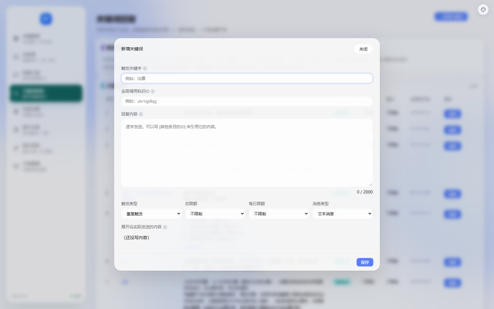

# 改造：关键词页（删上下移动 + 弹窗 UI）

> 日期：2026-10-14
> 店主：「把上下移动删除　新增关键词 回复内容和下方的四个下拉框的 UI 都优化一下」



---

## 一、删掉 ↑↓ 上下移动

**不只是听命 —— 那两个箭头给的是假的控制感。**

```
关键词回复的匹配是"买家的话里包含这个关键字，就回这条"。
顺序【对结果没有影响】：
  · 谁在前谁在后，匹配结果一样（关键字不能重复，保存时会检查）
  · 也没有"先匹配到的优先"这种规则
⇒ 能调顺序会让人以为顺序重要，其实不重要。
```

**删掉的东西**（不留死代码）：
```
· 表格操作列里的两个按钮
· 它们的 onclick 绑定
· move() 函数本身
```

---

## 二、弹窗 UI：根因是「从来没写过宽度」

**先量了实际尺寸**（不猜）：

```
弹窗 780px / 内容区 778px
触发关键字   173×31px    ← 只占 22%
全局标识ID   173×31px
回复内容     168×177px   ← 一个很窄的长条
四个下拉      98 / 85 / 85 / 98px
每格 grid    174.5px     ← 而 select 只有 98px
```

**173px 是 `<input>` 的浏览器默认宽度**（`size=20` × 字符宽）——
全项目**没有任何规则给这些控件设过宽度**。父容器 `.qf-item` 是 block、宽 734px，
控件本该撑满却没撑。

> ★ 这类"看起来没设计过"的界面，根因常常是**从来没写过宽度**，
> 而不是"宽度写错了"。找错方向会去改一堆无关的样式。

### 改了什么

```css
/* ① 控件撑满 */
.modal-body .qf-item > input,
.modal-body .qf-item > textarea,
.modal-body .qf-item > select { width: 100%; box-sizing: border-box; }

/* ② 回复内容给足高度 */
.qf-item > textarea { min-height: 180px; resize: vertical; }

/* ③ 四个下拉框那行留行间距 */
.qf-row { align-items: end; margin-bottom: 16px; }

/* ④ 窄屏 2 列（4 列时下拉被挤到看不出选了什么） */
@media (max-width: 620px) { .qf-row { grid-template-columns: repeat(2, minmax(0,1fr)); } }

/* ⑤ 弹窗加宽：780 里放两列文字 + 4 个下拉太挤 */
.modal-panel { width: min(860px, 92vw); }
```

**实测结果**：
```
弹窗 860px / 内容区 858px
触发关键字 814px   标识ID 814px   回复内容 814px
四个下拉 195 / 195 / 195 / 195px   每格 195px  ← 整齐了
```

---

## 三、★ 一个只有截图才能发现的问题

我第一版给 `.qf-row .qf-item { margin-bottom: 0 }`（行内各格不要各留外边距），
**但忘了给 `.qf-row` 本身留** ⇒ 下拉框那行和下面「展开后实际发送的内容」**贴在一起**。

**断言量不出"挤不挤"这种观感** —— 是靠看截图发现的。
补上 `margin-bottom: 16px` 后间距正常（实测 16px）。

---

## 四、断言（7 条）

```
★★ 表格里没有 ↑↓ 上下移动按钮
★★ move() 函数也删了（不留死代码）
★  编辑按钮还在（只删了箭头，别删错）
★★ 弹窗里的 input/textarea/select 设了 width:100%
★  回复内容给了最小高度
★  四个下拉框那行留了行间距（我漏过一次）
★  窄屏改 2 列
★  弹窗外层宽度已加大
```

---

## 五、状态

```
✅ 删掉 ↑↓（含绑定与 move()，不留死代码）
✅ 控件撑满 814px（原来是浏览器默认 173px）
✅ 四个下拉 195px 整齐
✅ 弹窗 780 → 860px
✅ 窄屏 2 列
✅ 7 条断言；33 套自检全过（42.7 秒）｜ _check_qa 22 项
```

**★ 顺带说明**：我把顺序列留在表里了（列表头的顺序号），
因为它能回答"我有多少条"；只是不再让人去"调"顺序。
