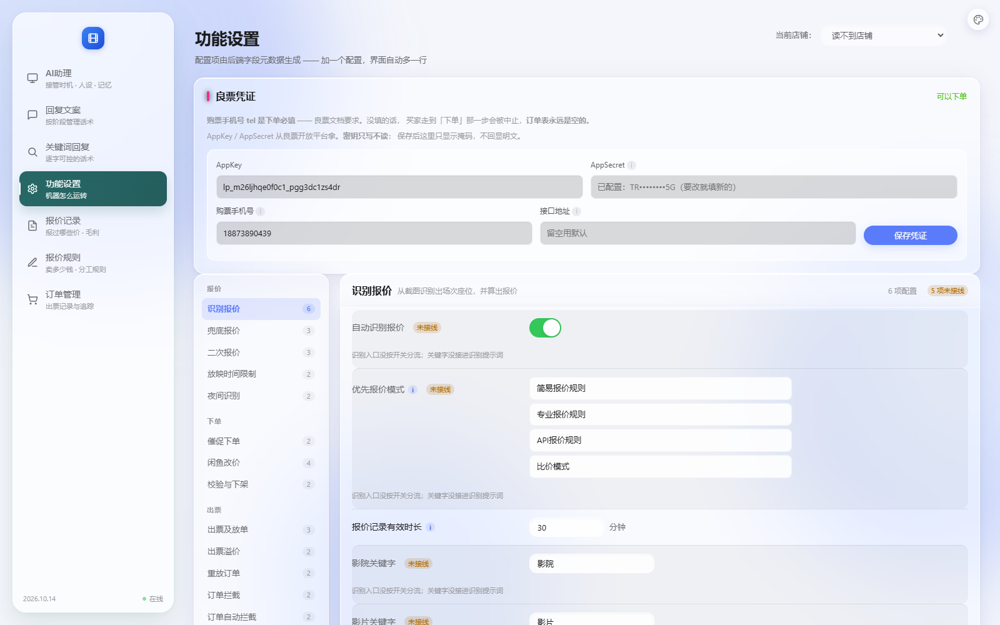

# 改造：内容页全部靠左（左间距 32px）

> 日期：2026-10-14
> 店主：「把所有内容页面全部靠左，并左间距设置为 32px」



---

## 一、改了什么

内容区原来是**居中**的（`max-width: 1420px` + `margin: 0 auto`）。

```css
/* 改前 */
.app-main > main { max-width: 1420px; margin: 0 auto; padding: 34px 20px 60px; }

/* 改后 */
.app-main > main { margin: 0; padding: 34px 32px 60px; }
```

**★ 靠左 = 去掉两样东西**：`max-width` 和 `margin: 0 auto`
—— 这两样就是"居中"的全部原因，留着任何一样都会继续居中。

**左间距 32px**（原 20px）。**右侧也留 32px** —— 不然表格会顶到视口边，
横向滚动条贴边很难看。

---

## 二、★ 差点改错的地方：CSS 里有**三条**规则都管内容区

```
main { padding: 0 20px 60px; max-width: 1420px; margin: 0 auto; }
main { max-width: 1420px; margin: 0 auto; padding: 34px 20px 60px; }   ← 重复
.app-main > main { max-width: 1420px; margin: 0 auto; padding: 34px 20px 60px; }
                  ↑ 更具体 ⇒ 真正生效的是这条
```

**⇒ 只改裸 `main` 是不会生效的。**
所以我没有靠读 CSS 判断，而是**让浏览器算出来**：
```
实测 8 个页面 → padding-left 全是 32px、margin-left 0、max-width none ✓
```
另外两条旧规则也顺手去掉了居中 —— 万一以后有页面不套 `.app-main`，
不该突然又居中。

---

## 三、靠左带出来的两个观察（都不是 bug，但要知道）

### 1. 宽屏右侧会空一大片

```
视口宽   →  输入框宽  /  内容列宽  /  卡片宽
  1280   →    200px       666px      704px
  1600   →    200px       986px     1024px
  1920   →    200px      1306px     1344px
  2560   →    200px      1946px     1984px
```

输入框是**固定 200px**（`.cfg input { width: 200px }`），所以它不会被拉长；
但卡片会撑到全宽 ⇒ 右侧留白。

**这是店主明确要的效果**（"全部靠左"），不是疏漏。
★ 我在 CSS 注释里写明了这一点，免得以后有人看到"空一片"就顺手加回居中。

### 2. 配置页的「优先报价模式」列表右侧空一块

```
행布局是 grid: 260px(标签) + 内容列
而 .sortable { max-width: 420px }   ← 这条【原本就有】，不是靠左导致的
⇒ 宽屏上内容列 986px，列表只占 420px，右边空 566px
```
★ 这一条**和靠左无关**（靠左只是让它更明显）。要不要放宽 `.sortable`
是另一个决定，我没动 —— 排序列表本来就不需要很宽。

---

## 四、窄屏没被弄坏

1280 下逐页检查横向溢出：
```
✓ AI助理 / 回复文案 / 关键词回复 / 功能设置 / 报价记录 / 订单管理 / 组件预览
  —— 页面级溢出 0、越界元素 0
· 报价规则：TABLE.rules-table 越界
  ★ 这是【有意的】—— 表格 min-width: 1114px，外层 .rules-table-wrap
    有 overflow-x: auto，所以是"表格内部横向滚动"，页面本身不溢出
```

---

## 五、断言（5 条）

```
★  找到了 .app-main > main 规则
★★ 内容区左间距 32px
★★ 内容区不再居中（没有 margin:auto / max-width）
★★ 左右内边距对称（右边也 32px）
★  旧的裸 main 规则也不带 margin:auto（防回退）
★  注释写明了「靠左是店主指定的」（防后来人顺手改回居中）
```

**★ 其中一条我改了两版才对**：
```
第 1 版：查措辞 "不要" + "加回居中"
         —— 实际注释写的是「不要「顺手」加回居中」，中间夹了引号 ⇒ 假失败
第 2 版：查锚点，但查的是 _css_code
         —— ★ _css_code 是【剥过注释的】CSS，而我要查的东西在注释里 ⇒ 永远失败
第 3 版：查原始 _css ✓
★ 规律：先想清楚"这东西在注释里还是在代码里"，再选变量。
  （这是本项目第 6 次栽在"搜错地方 / 搜到自己的注释"上。）
```

---

## 六、状态

```
✅ .app-main > main：靠左 + 左间距 32px（右侧也 32px）
✅ 另外两条旧规则也去掉居中
✅ 实测 8 个页面：padding-left=32px / margin-left=0 / max-width=none
✅ 1280 窄屏逐页无横向溢出
✅ 5 条断言；33 套自检全过（46.9 秒）｜ _check_orders_ui 150 项
```
