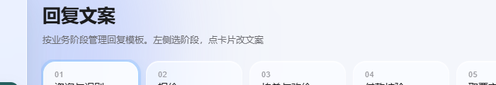

# 改造：删「闲鱼」标签 + 当前店铺从接口读

> 日期：2026-10-14
> 店主：「这里的咸鱼 去掉，然后当前账号 读取当前店铺配置」


---

## 一、删掉顶部「闲鱼」标签

```
index / config / rules 三个页面的 header-right 里各有一个：
  <div class="plat-tabs"><button class="plat-tab active">闲鱼</button></div>
⇒ 已删。目前只做闲鱼一个平台，只有一个选项的切换器是噪音。
（orders / quotes / qa 三个页面本来就没有这个。）
```

### ★★ 我在这里删错过一次，记录一下

```
`.plat-tabs` 这个 class 【同时用在两个地方】：
  ① 顶部那个「闲鱼」标签            ← 店主说删的是这个
  ② 「回复文案」面板里的渠道切换器  ← 这是功能，不能删
     全局 / 万达 / 良票（data-channel=global/wanda/liangpiao）

我一开始按 class 名把 `.plat-tabs` / `.plat-tab` 的样式【全删了】
⇒ 渠道切换器变成三个裸按钮。

发现方式：删完复核时看到 index.html 里还剩 4 个 plat-tab，
         点进去看才发现那是渠道切换器。
已把样式补回，并把注释改成"现在只有渠道切换器用它"。
```



**同类风险**：以后遇到"按 class 名删样式"时，先全文搜这个 class 有几个用途。

---

## 二、当前店铺从接口读

### 2.1 数据从哪来（决定了为什么要新写一个文件）

```
只有【插件进程】能拿到店铺列表 —— 它持有鱼麦多的 client（带 pluginToken），
调 core.shops.list()。后端进程没有那个 client。

链路：
  浏览器 → 后端 /api/shops → 插件 /internal/shops/read → 鱼麦多
                                  ↑
                   插件早就开了这个端点给后端用，
                   但后端【一直没调它】—— 这次补上。
```

### 2.2 新增了什么

```
① integrations/yumaiduo/shop_client.py   ← 新增（出站客户端）
     按插件的验签算法签名：
       X-Yumaiduo-Timestamp: 毫秒时间戳
       X-Yumaiduo-Signature: hmac_sha256(secret, f"{ts}.{rawBody}") 的 hex
     ★ 签的是 `ts.rawBody`（点号连接），不是只签 body；
       时间戳是【毫秒】（SDK 用 Number() 跟 Date.now() 比），容差 ±300s。
     ★ 已用同算法自证一致（测试里跟 hashlib 直接算的比对过）。
② server.py 加 /api/shops 路由
③ web/shops.js  ← 新增（前端；同时填「当前店铺」和推送栏两个下拉）
④ index/config/rules 三个页面挂上 shops.js
```

### 2.3 ★ 失败不静默：把原因显示出来

`/api/shops` **不返回 500**，而是带一个 `error_code` 回来：

| error_code | 含义 |
|---|---|
| `PLUGIN_SECRET_MISSING` | 插件还没自注册（拿不到密钥） |
| `PLUGIN_UNREACHABLE` | 连不上插件进程 / 地址不对 |
| `SHOP_SCOPE_REQUIRED` | 租户没同意 `account.read` |
| `PLUGIN_SIGNATURE_REJECTED` | 两边密钥不一致 |
| `TENANT_ID_MISSING` | 没配租户 id |

**为什么不返回空列表**：那会让界面显示"没有店铺"，
而真实原因是"插件不通/没配密钥" —— 两种情况的处置完全不同。

**实测（本地没插件进程，走的就是这条降级路径）**：
```
当前店铺下拉 = 禁用，显示「读不到店铺」，title=插件还没自注册（拿不到密钥）
推送栏提示   = 读不到店铺（插件还没自注册（拿不到密钥））
JS 无报错，控制台留一条 warn 便于排查
```

### 2.4 标签也统一了

```
「当前账号：」→「当前店铺：」
★ 同一屏里不该有两个叫法（推送栏早就写的是"店铺"）。
```

### 2.5 还顺手做的两件小事

```
· 下拉里「未启用」的店铺会标出来（platform_enabled=false）
· 选过的店铺记在 localStorage —— 换页不用重选（纯界面偏好，不是业务状态）
```

---

## 三、实测（两条路都验了，不只验碰巧没数据的那条）

```
① 真链路（本地没插件）：正确降级、禁用、说明原因、无 JS 报错   ✓
② 有数据时（拦截 /api/shops 返回假店铺）：
     当前店铺下拉 = ['unb-aaa=代买w位置', 'unb-bbb=万达w位置代买（未启用）']
     默认选中第一个 ✓   未启用的带标注 ✓
     推送栏下拉 = ['=请选择店铺', 两个店铺] ✓
     推送提示自动加上「（来源于鱼麦多店铺列表）」
③ 换页记住：在 /rules 选 unb-bbb → 到 /features 仍是 unb-bbb ✓
```

---

## 四、新增 6 条断言

```
★  三个页面的顶部没有「闲鱼」标签了
★★ 「全局/万达/良票」渠道切换器还在（3 个）
★★ 渠道切换器的胶囊样式在（.plat-tabs / .plat-tab）
★★ 后端有读店铺的出站客户端（调插件 /internal/shops/read）
★★ 后端有 /api/shops 路由
★★ 前端有 shops.js 且三个页面都挂了
★  标签统一叫「当前店铺」（不再出现旧叫法）
```

**★ 前两条要一起断**：`.plat-tabs` 同名两用，
只断"该删的删了"会漏掉"不该删的被删了"（我第一次就是这么错的）。

---

## 五、状态

```
✅ 顶部闲鱼标签已删（3 页）| 渠道切换器样式已补回
✅ /api/shops 全链路：出站客户端 + 路由 + 前端 + 三个页面接线
✅ 标签统一「当前店铺」| 本地无插件时正确降级
✅ 33 套自检全过（41.9 秒）| _check_orders_ui 126 项
```

**跑真链路还差一步**：本地没起插件进程（`yumaiduo/plugin-runtime`）。
真机上插件起来、`YUMAIDUO_AUTO_REGISTER=true` + `BASE_URL` 配好后，
把 `V5_BACKEND_SECRET_FILE` 指到交接文件、`YUMAIDUO_PLUGIN_URL` 指到
插件地址，这个下拉就会出真实店铺。
