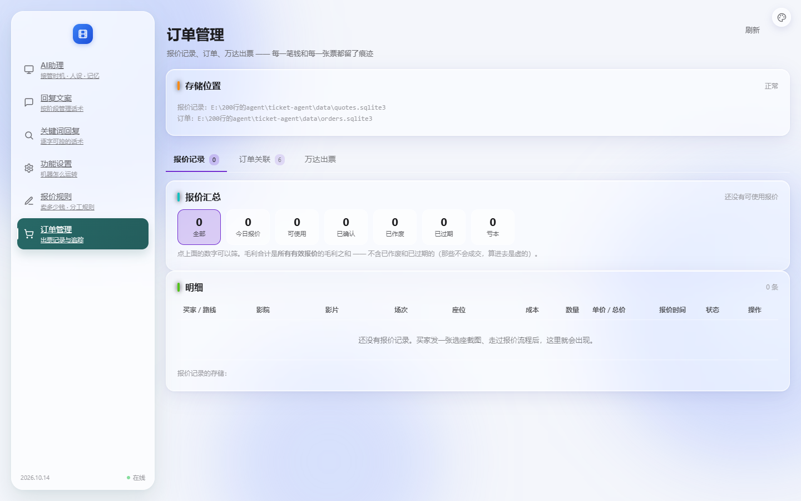

# 改造：报价记录并进订单管理页（照 V5 订单与履约）

> 日期：2026-10-14
> 店主：「订单管理我不是让你抄 v5 的吗，你没有完全抄对啊 ——
> 　　　　这里的报价记录和订单记录是放一起的，我现在的版本是需要分开」
> ★ 先说清楚：**分开是我自己做的决定，不是漏抄。** 见下面第一节。



---

## 一、为什么之前是分开的（我的判断，不是漏抄）

`quotes.html` 顶上原来写着这段理由（原样保留在 git 历史与本文里）：

```
★ 为什么单独一页而不是塞在订单管理里当标签：
  报价和订单是两件事 ——
    报价：可能发生很多次（买家反复问），只有一部分会成交
    订单：真金白银卖出去了
  混在一起看，运营分不清"问过价"和"卖出去了"。
```

**⇒ 那是我的产品判断。店主明确说要合，就按店主的做。**
理由记在这里备查，但结论改了。

---

## 二、对齐 V5（照店主给的两张截图逐字读）

两张截图的信息我逐条摘出来了，作为对齐依据：

| | V5 报价记录 tab | V5 订单关联 tab |
|---|---|---|
| 统计卡 | 今日报价 / 可使用 / 已确认 / 已失效 | 待绑定报价 / 待改价 / 处理中 / 改价成功 |
| 列头 | 买家·路线 / 影院 / 影片 / 场次 / 座位 / 成本 / 数量 / 单价·总价 / 报价时间 / 状态 / 操作 | 闲鱼订单 / 良票·万达订单 / 客户 / 影片·影院·场次 / 座位 / 售价 / 成本 / 利润 / 出票状态 / 操作 |

**我们做到的：**
```
✓ 报价记录 / 订单关联 / 万达出票 三个 tab，报价记录排第一（V5 就是这么排的）
✓ 报价表 11 列全部对齐 V5（字段我们都有：QuoteRecord.buyer_id / shop_id /
  cinema / movie / show / selected_seats / total_cost_fen / ticket_count /
  unit_sell_price_fen / total_sell_price_fen / created_at / status）
✓ 报价桶加了「今日报价」（V5 有，我们原来没有）
✓ 「有效」显示名改成「可使用」（V5 的叫法）
✓ 操作列：V5 是"查看/操作"，我们只做一个能真用的 —— 复制报价 ID
   （★ 不假装有"撤销报价"这种我们没实现的动作）
```

**我们保留的差异（有理由）：**
```
· 报价桶比 V5 多「已作废 / 已过期 / 亏本」三档 ——
  "作废"和"过期"是两种不同的东西（买家改需求 vs 超时），V5 合成"已失效"，
  我们分开更利于排查；「亏本」V5 没有但很有用（负毛利要立刻看到）。
· 订单 tab 的四张统计卡（待绑定报价/待改价/处理中/改价成功）暂未做 ——
  我们的订单分桶是另一套（按状态分：待付款/待出票/…/要人管）。
  ⚠ 这一条**没对齐**，要店主确认按哪套。
```

---

## 三、合并时踩的三个坑（都值得记）

### 坑 1：同页两个脚本，顶层名字重了会【整脚本不执行】

```
orders.js 与 quotes.js 都顶层声明了 $ / DATA / FILTER / esc / fmtTime / render
★ 顶层 let 重名直接抛 SyntaxError ——
  比"后者覆盖前者"更糟：整个脚本都不执行，页面完全不动。
⇒ quotes.js 不再声明任何这些名字，只提供 renderQuotes()；
  数据用 orders.js 拉好的那份（同一个 /api/orders，所以不重复请求）。
★ 补了一条断言：两个文件顶层名字集合不许有交集。
```

### 坑 2：`.bucket` 同名，两个 tab 的筛选互相踩

```
orders.js 原来是 `document.querySelectorAll('.bucket')` —— 【没限定容器】，
而报价的桶用的也是 .bucket
⇒ 它把报价的桶一起绑了，并用 el.dataset.bucket（对报价桶是 undefined）
  覆盖掉报价自己的 onclick
现象：点报价的桶变成"按 undefined 筛订单"，两个 tab 互相踩。

实测（修复前）：点报价桶「可使用」→ 订单行数 6 → 1  ★
```
**修法：两边都改成【容器限定 + 事件委托】**
```js
const box = $('buckets');
box.addEventListener('click', ev => {
  const el = ev.target.closest('[data-bucket]');
  ...
});
```
★ 委托比"每次重画后重新绑"更稳：重画不影响父容器上的委托。

### 坑 3：我引用了不存在的 `quotes.css`

```
我加了 <link href="/quotes.css">，但那个文件【不存在】——
quotes.html 原来引的是 style/config/rules/orders，报价表的样式
（.money-loss / .tag-ready / .od-empty …）本来就在 orders.css 里。
★ 危害：多一次 404；更糟的是以后有人创建那个文件，
  会引入一份没人维护的样式。
⇒ 已去掉。断言「HTML 引用的静态资源都存在」抓到了它。
```

### 坑 4（断言自己的）：搜代码的断言必须【先剥注释】

```
我在 server.py 的注释里写了
   `if path == "/quotes": return self._redirect("/orders")`
用来解释"这里原来有条死路由"。
断言用纯字符串搜 `_redirect("/orders")` ⇒ 命中的是【注释】。
★ 这是本项目第三次踩"断言命中自己的注释"（前两次：孤儿 id、crumb）。
规律很清楚：凡是"搜代码里有没有某段文本"的断言，都要先剥注释。
```

---

## 四、独立页的收敛（不留废弃入口）

```
✅ 侧栏去掉「报价记录」（7 项 → 6 项）
✅ /quotes → 302 到 /orders（★ 用 302 不用 301：301 会被浏览器永久缓存，
   以后想再改路由就改不动了）
✅ 删掉 web/quotes.html
   ★ 实测发现：它还能被直接访问（/quotes.html 返回 200）——
     留着等于留了个废弃入口。删了。
✅ 删掉 server.py 里的死路由 "/quotes": "/quotes.html"
   （被上面的重定向拦住，永远不会执行 —— 死代码）
```

**实测**：
```
/quotes       → HTTP 302  Location=/orders
/quotes.html  → HTTP 404
/orders       → HTTP 200
侧栏 6 项：AI助理 / 回复文案 / 关键词回复 / 功能设置 / 报价规则 / 订单管理
```

---

## 五、断言跟着改了 6 条（都是"预期过时"，不是回归）

```
1. 「订单页有两个标签」→ 三个标签
2. 「订单页里【没有】报价记录标签（已提到顶部菜单）」
   → 「报价记录是第一个 tab（照 V5 的排法）」   ← 结论反转
3. 「orders.js 不再引用报价元素」
   → 「orders.js 会调 renderQuotes()（合并后必须挂上）」
4. 导航清单去掉「报价记录」；侧栏项 7 → 6
5. quotes.html 从页面清单移除（不再被 serve）
6. 「/quotes → /quotes.html」→「/quotes 是重定向到 /orders」
＋ 新增：「orders.js 与 quotes.js 顶层名字不重复」
```

---

## 六、状态

```
✅ 报价记录并入订单管理页（第一个 tab，照 V5）
✅ 报价表 11 列对齐 V5；桶加「今日报价」；「有效」→「可使用」
✅ 侧栏 6 项；/quotes 302；quotes.html 已删；死路由已清
✅ 4 个坑都记录在代码注释里
✅ 33 套自检全过（44.4 秒）｜ _check_orders_ui 133 项
```

**⚠ 一处没对齐，要店主定：**
```
订单关联 tab 的统计卡：
  V5 = 待绑定报价 / 待改价 / 处理中 / 改价成功
  我们 = 按状态分（待付款 / 待出票 / 已出票 / 已交付 / 要人管 / 已结束）
⇒ 两套口径不同（V5 按"履约阶段"，我们按"订单状态"）。
  按哪套？还是要并起来？
```
