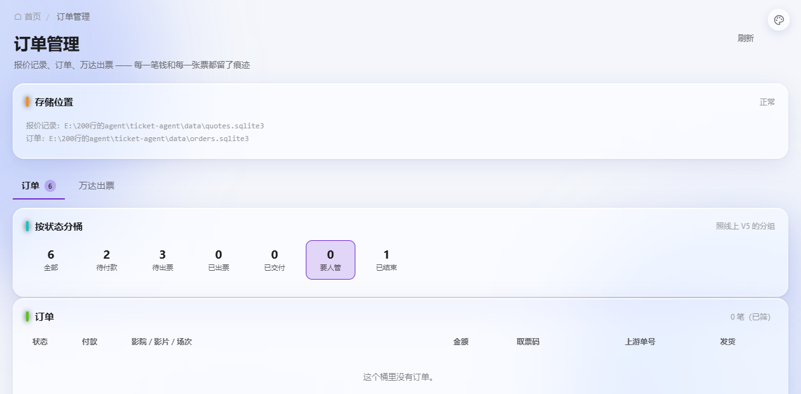

# 改造：推送栏改店铺 + 订单页三个真 bug

> 日期：2026-10-14
> 店主：「分组推送删除，直接推送店铺就行」
> 　　　「按状态分桶，照线上 V5 的分组…点桶可以筛」
> 　　　（最后那个「删除」= **删掉那段说明文案**）

---

## 一、推送栏：删分组、账号改叫店铺

三个页面（`index.html` / `config.html` / `rules.html`）都改了：

```
改前： 批量推送：[请选择分组 ▾] [请选择账号 ▾]  将当前闲鱼配置推送到所选账号
改后： 批量推送：[请选择店铺 ▾]                将当前闲鱼配置推送到所选店铺
```

```
✓ 分组下拉已删（wide-220 那个 class 也一并清了）
✓ 账号 → 店铺（鱼麦多把闲鱼账号叫 shop）
✓ 三种文案各自对齐：配置 / 功能设置 / 规则
```

### ★ 语义我先跟你确认过，没自作主张改

原来的文案是「将当前闲鱼**配置/规则/功能设置**推送到所选账号」——
也就是**把一个店铺的配置复制给其他店铺**。
你说的是「直接推送店铺就行」，我担心理解成"把订单推给店铺"（那是完全不同的功能），
所以先问了一句。你选的是 **A：保留语义，只把「账号」改叫「店铺」**。

### ⚠ 店铺列表还没接（说清楚，不假装有）

```
下拉现在只有占位项「请选择店铺」。
列表来源应该是鱼麦多的 GET /shops（PluginShopView：
  unb / displayName / shopName / status / enabled / imEnabled / area / avatar / remark）。

为什么还没接：仓里的鱼麦多客户端（integrations/yumaiduo/）只有【命令队列】，
没有 HTTP 客户端，拉不了 /shops。要新写一个（签名 + 鉴权 + 错误处理）。
★ 这跟「店铺管理」页是同一件事的前置 —— 做完那个，这个下拉自然就有数据了。
```

---

## 二、★★★ 订单页：查出并修了三个真 bug

这一页原来是**完全空白**的（桶、订单列表都没有）。原因不是一个，是三个叠在一起。

### bug 1：JS 引用了一个从不存在的元素 ⇒ 整页空白

```js
// web/orders.js 原第 330 行
$('btn-gen-secret').onclick = generatePluginSecret;
```

```
#btn-gen-secret  这个元素【不存在】（HTML 里没有）
generatePluginSecret  这个函数【不存在】（全仓没定义）

★ 它在 IIFE 里、且在 load() 之前
⇒ 执行到这里抛 TypeError: Cannot set properties of null
⇒ 后面的 load() 永远不执行 ⇒ 桶、订单列表全没有

★★ 为什么所有测试都过了：
   测试验的是"渲染后的 DOM 结构"（表格在不在、告警区在不在），
   空表照样"结构正确"。页面也不报错，只是空。
   ⇒ 这类错只能用「引用 vs 存在」的静态比对抓。
```

**修**：删掉这行死代码（秘钥是手填后点「保存」的，不需要"生成"按钮）。

### bug 2：`AWAITING_PAYMENT` 没进显示字典 ⇒ 状态显示英文、且归错桶

```
订单库【真的】会写这个状态：
  application/ticket_flow.py:1683  state="PAID" if paid else "AWAITING_PAYMENT"
  application/ticket_flow.py:1810  state="AWAITING_PAYMENT"
但 ORDER_STATE_LABELS / ORDER_STATE_BUCKETS 里只有 "CREATED"。

⇒ 两个后果（订单页实测看到的）：
   ① 状态列直接显示英文 "AWAITING_PAYMENT"，
      而旁边的桶按钮写的是「待付款」—— 同一行两种叫法
   ② 它落进默认桶（显示上算进 attention）
      ⇒「要人管」桶凭空多了 1 笔（实测 2 笔 → 修完 1 笔）
      ★ 待付款是【正常路径的第一格】，本来就不是"要人管"
```

**修**：两个字典都加上 `AWAITING_PAYMENT`（保留 `CREATED` 同时认两个 ——
库里两种都可能存在，历史数据 + 新写入）。

**修完实测**：
```
AWAITING_PAYMENT  label=待付款  bucket=unpaid      ← 修前是英文 + attention
PAID              label=待出票  bucket=awaiting_ticket
CANCELLED         label=已取消  bucket=closed
```

### bug 3：桶的说明文案（你让删的那段）

```html
<!-- 删掉的 -->
<p class="hint">
  <b>待付款 → 待出票 → 已出票 → 已交付</b> 是正常路径；
  <b>待改价 / 出票失败</b>是要人管的（线上叫 attention 桶）。
  点桶可以筛。
</p>
```

---

## 三、状态分桶：已经在做，而且和你说的完全一致

你要求的：

```
待付款 → 待出票 → 已出票 → 已交付   是正常路径
待改价 / 出票失败                   是要人管的（线上叫 attention 桶）
点桶可以筛
```

仓里**已经是这样**了（`application/store.py`）——我核对过，一处不差：

| 状态 | 桶 | 你说的 |
|---|---|---|
| CREATED / AWAITING_PAYMENT | `unpaid` | 待付款（正常） |
| PAID | `awaiting_ticket` | 待出票（正常） |
| TICKETED | `ticketed` | 已出票（正常） |
| DELIVERED | `delivered` | 已交付（正常） |
| REPRICE_PENDING | `attention` | 待改价（要人管） |
| FAILED | `attention` | 出票失败（要人管） |
| CANCELLED / REFUNDED | `closed` | 已结束 |



**实测**：点「要人管」→ 行数 6 → 1，选中态正确 ✓

---

## 四、★ 补了一道断言，防止 bug 1 再出现

加进 `tests/_check_orders_ui.py`：

```
★★★ JS 引用的元素 id 都真实存在（缺一个就可能整页空白）
```

**判据我绕了三次才对**（记录下来，免得以后又走弯路）：

```
① 拿静态 HTML 里的 id 比 —— 假阳性：
   theme.js 会【自己创建】#theme-btn / #theme-panel / #theme-custom
   （色盘是 JS 挂上去的），静态比会把色盘那 3 个全报成孤儿。
② 用正则/状态机剥 JS 注释再比 —— 也出问题：
   · 正则处理不了「字符串里出现 //」；
   · 我手写的字符状态机在 orders.js 上仍有 bug：
     喂全文时把 //   $('btn-gen-secret')... 这行留了下来，
     只喂后半段却是对的（毒在前面的某个反引号模板串里）。
   ★ 教训：不该在一个纯工具函数上反复纠缠。
③ ✅ 最终用【逐行】剥离（笨但可验证）：
     行首是 // → 整行丢；块注释按行状态处理；其余保留。
     本仓的写法里注释都是整行的、字符串不跨行，够用。
```

**这个断言只是第三道网，不是唯一防线**：
```
① node --check      → 语法错（整个文件解析失败）
② 浏览器 pageerror  → 运行时错
③ 本断言           → 引用了元素 id 但 HTML/脚本里都没有
工具不完美没关系，只要不误报、不漏真错。
```

---

## 五、这一轮的状态

```
✅ 推送栏：删分组 + 账号改叫店铺（3 页）
✅ 订单页 3 个 bug：整页空白 / 状态英文+归错桶 / 说明文案
✅ 状态分桶核对：和店主说的完全一致（原本就对）
✅ 新增断言：JS 不许引用不存在的元素
⚠ 店铺列表（GET /shops）还没接 —— 要新写鱼麦多 HTTP 客户端
   这是「推送铺下拉」和「店铺管理页」共同的前置

33 套自检全过（42.8 秒）
```
