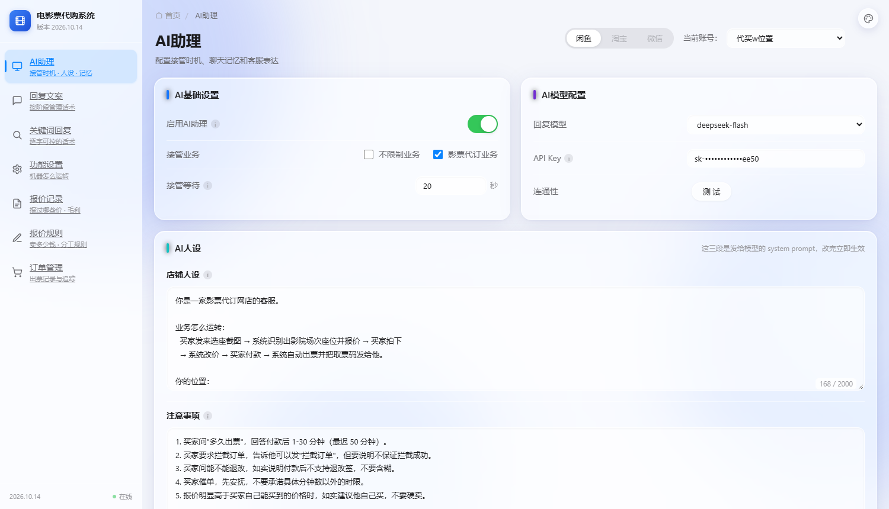
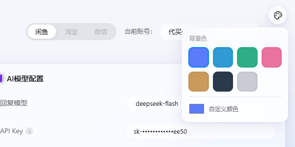

# 背景色可换 + 右上角色盘

> 日期：2026-10-14
> 店主：「背景色太丑了 换一下 或者右上角添加一个色盘 让我自己选择」
> ⇒ 两件都做了：默认背景换干净了，并且右上角给了色盘。



---

## 一、背景为什么丑（老做法的问题）

```css
/* 改前 */
body::before { background: radial-gradient(...#7ac7ff, #4a7cff 70%); opacity: .55 }
body::after  { background: radial-gradient(...#ffb3d9, #b07cff 70%); opacity: .55 }
.orb         { background: radial-gradient(...#9dffd8, #35d6ff 70%); opacity: .55 }
```
```
· 三组颜色【硬编码】，想换只能改 CSS（所以店主说"改不动"）
· 蓝 + 粉紫 + 青绿三个球都是 blur(60px)、opacity .55
  ⇒ 糊在一起就是一大片紫粉，而且青色和粉紫叠出来发灰
· 底色写死 #eef1f7，跟光斑各管各的
```

---

## 二、改成什么

### 2.1 一个主题 = 两个变量

```css
:root, :root[data-theme="mist"] { --bg-base: #f4f6fb; --bg-accent: #5b7cfa; }
:root[data-theme="paper"] { --bg-base: #f7f4ef; --bg-accent: #c99a5b; }
…（共 7 个）
```
**光斑颜色从 `--bg-accent` 用 `color-mix()` 推出来** —— 不用给每个主题手写三组渐变色。
**★ 这是关键**：老做法每加一个主题要写 3 处颜色，迟早出现
"改了底色忘了改光斑"的配色断层。

### 2.2 变淡了、也变干净了

```
opacity: 0.55 → 0.30（原来太抢眼）
blur:    60px → 70px（更糊，看不出是"球"）
光斑色：三色乱配 → 单色系（同色不同深浅）
底色：  #eef1f7（偏冷灰）→ 随主题走
```

### 2.3 七个主题

| key | 名字 | 底色 | 气质 |
|---|---|---|---|
| `mist` | 雾蓝 | `#f4f6fb` | **默认**，干净不抢内容 |
| `sky` | 天青 | `#eff6fc` | 偏亮 |
| `mint` | 薄荷 | `#f0f7f4` | 清爽 |
| `rose` | 藕荷 | `#fbf3f6` | 柔和 |
| `paper` | 暖纸 | `#f7f4ef` | 护眼 |
| `ink` | 墨灰 | `#eef1f6` | 极简（近灰） |
| `plain` | 无光斑 | `#ececef` | 完全没有颜色 |

**另加「自定义颜色」**：原生取色器，选任意色 → 底色由它调淡 5% 得出。

---

## 三、色盘（右上角）



```
· 右上角一个圆形按钮（毛玻璃，和侧栏/卡片同一套质感）
· 点开：7 个色块 + 一个自定义取色器
· 选中项有蓝框
· 点面板外面 / 按 Esc 关闭
· 存 localStorage → 六个页面共用（换一页就丢等于没有）
```

### 3.1 ★ 为什么放右上角而不是塞进顶栏

```
放右上角：正好是各页 header-right（渠道切换 / 当前账号）的地盘 ——
         实测确实压住了，所以给 .header-right 让出 52px 位置（见下）
塞进 header-right：它是全站共用组件，而各页 header-right 内容不一样
         （有的页面根本没有）⇒ 有的页面会掉位
⇒ 选固定定位 + 给页面留位，是两边都不动的方式。
```

**实测踩到两次位置问题：**
```
① 色盘按钮压住"当前账号"选择器
   → .header-right { padding-right: 52px }（52 = 按钮 34 + 两边留白）
② 展开的面板又压住一次
   → 面板改成往左展开（right: -4px）
```

### 3.2 ★ 只给一个色，不是"底色 + 光斑"两个

两个色随便配很容易配出更难看的东西。**一个色 = 闭眼选都不丑**，
光斑和底色都从它推出来。

---

## 四、★ 我在这一改里踩的三个坑（都留了记录）

### 坑 1：CSS 注释用 HTML 的结束标记收尾 ⇒ 吞掉默认主题

```css
/* ============ 主题
   ...
   ★ ...切换；没设就用 :root 里的默认值 -->      ← ★ 这是 HTML 的写法
:root, :root[data-theme="mist"] { ... }          ← 整段被吞进注释
html { background: var(--bg-base); }             ← 也被吞
```
**CSS 注释必须用 星号加斜杠 收尾。** 后果：
```
· light 模式下所有主题都退回浏览器默认白（变量根本没定义）
· dark 模式【正常】—— 因为 dark 那段在注释之后，没被吞
⇒ 表现是"换主题没反应"，但只有浅色不生效，很容易以为是缓存
```
**★ 语法检查发现不了。是 Chrome 截图 + `getComputedStyle` 实测才看出来的**
（截图里背景一片死白，变量读出来是空串）。

### 坑 2：我在写坑 1 的记录时，又踩了一次同一个坑

注释正文里写了"必须用 星号加斜杠 收尾"—— **那个符号本身把注释提前关掉了**。
⇒ **注释里不要出现注释的闭合符号。**

### 坑 3：底色只铺 body，读出来是透明

```
getComputedStyle(body).backgroundColor → rgba(0,0,0,0)
```
虽然视觉上没差（html 会兜底），但**"变量没生效"看起来就像"换主题失败"**。
改成 `html { background: var(--bg-base) }` —— 也顺带解决了滚到最底下露白。

### 坑 4（写断言时）：注释剥离写法不对，误报

**跨行注释的【续行】里没有 `/*`**，所以 `line.split("/*")[0]` 那种写法
对续行无效，整行被当代码 ⇒ 注释里那句"老做法硬编码了 #ffb3d9"
把自己判成"还留着老色"，白误报一次。
⇒ 改成**按注释状态逐字符剥离**。

---

## 五、安全：自定义色的白名单

值会被写进 `style` 属性，所以必须校验：
```js
function safeColor(v, fallback) {
  return /^#[0-9a-fA-F]{6}$/.test(String(v || '')) ? v : fallback;
}
```
**实测注入尝试**（`?theme=<svg/onload=alert(1)>`）→ 不生效，回落到合法值。

---

## 六、URL 参数（顺带做的）

```
?theme=mint           → 用预设
?theme=%23ff0000      → 自定义色（传 #RRGGBB）
```
方便截图比对，也方便店主把喜欢的色发链接给别人。

---

## 七、钉住的断言（`tests/_check_orders_ui.py` 新增 10 条）

这块最容易出的是**静默失效**（能点但颜色不变），而语法检查/断言全绿：

```
★★ CSS 注释开合平衡（注释吃掉规则是最阴的错）
★★ 七个主题的 CSS 都在
★  默认主题（mist）不依赖 data-theme 也有值
★  底色铺在 html 上
★★ 光斑颜色从 --bg-accent 推（color-mix），不硬编码
    ★ 只查真实代码不查注释（否则误报 —— 我踩过）
★  右上角给色盘让了位
★★ theme.js 存在且是普通脚本
★★ 自定义色做了白名单校验
★  主题存 localStorage
★★ 六个页面都挂了色盘与 theme.js
```

---

## 八、实测结果

```
① 控件挂载：按钮 1 / 面板 1 / 色块 7 / 自定义 1
② 七个主题逐个切：data-theme 与 --bg-base/--bg-accent 全部正确
     mist  #f4f6fb / #5b7cfa     sky   #eff6fc / #2f9bd4
     mint  #f0f7f4 / #2fae86     rose  #fbf3f6 / #e8749e
     paper #f7f4ef / #c99a5b     ink   #eef1f6 / #2b3a4a
     plain #ececef / transparent
③ 跨页保持：在 / 选 mint → 到 /orders 仍是 mint ✓
④ 自定义色：#ff7a1a → 跨页到 /qa 仍是 custom ✓
⑤ URL 参数：?theme=rose ✓  ?theme=#ff0000 ✓  注入串不生效 ✓
⑥ 截图自查 6+ 张（就是靠它发现坑 1 和那两个压位置问题）
```

---

## 九、状态

```
33 套自检全过（47.9 秒）｜ _check_orders_ui 108 项（+10）
服务 8801 已恢复 ｜ 临时文件干净 ｜ 预览图在 docs/img/
```

**没动任何业务逻辑** —— 只改了背景与加了色盘。
