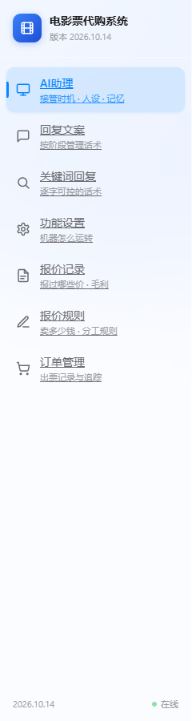

# 顶部菜单 → 左侧栏（图二效果）

> 日期：2026-10-14
> 店主给的图二：左侧常驻侧栏（品牌头 + 图标菜单 + 底部在线状态）
> 并附了线上那段的 HTML 结构（Tailwind 类名 `ticket-sidebar` / `ticket-nav-item`）



---

## 一、改了什么

```
原来：<div class="top-tabs"> 顶部一排胶囊，sticky
现在：<div class="app-shell">
        <aside class="ticket-sidebar">   240px 常驻左栏（玻璃，和内容区同一套参数）
        <div class="app-main"><main>     右侧内容区
```

**覆盖到全部 6 个页面**（不是只改首页 —— 手改 6 遍必然漏一页）：

| 页面 | 路由 | 侧栏选中项 |
|---|---|---|
| index.html | `/` `/replies` | AI助理 / 回复文案 |
| config.html | `/features` | 功能设置 |
| qa.html | `/qa` | 关键词回复 |
| rules.html | `/rules` | 报价规则 |
| quotes.html | `/quotes` | 报价记录 |
| orders.html | `/orders` | 订单管理 |

**★ 类名沿用店主给的那套**（`ticket-sidebar` / `ticket-nav-item` /
`sidebar-scroll` / `ticket-sidebar-brand` / `ticket-sidebar-foot` / `dot-online`）——
那是他线上在用的命名，同名以后对照线上样式不会对不上。
线上是 Tailwind，我们这里是手写 CSS，所以那几个工具类对应的效果在
`web/style.css` 里逐条写出来了。

### 视觉细节（对齐图二）

```
品牌头：渐蓝圆角方块 + lucide film 图标 + 「电影票代购系统」+ 版本号
菜单项：图标 + 标题 + 一行灰色副标题
选中项：淡蓝底 + 左侧一道 3px 圆角竖条 + 文字变蓝（图二的两个特征）
底部：  版本号 + 绿点「在线」（带轻微呼吸动画）
```
**保留了原有的 iOS 液态玻璃风格**（`--glass-bg-strong` + blur），
没有换成图二的不透明白 —— 因为整个工作台都是玻璃质感，侧栏单独不透明会显得断层。

### 只放【真的实现了】的页面

```
图二里有但本工作台没做的：出票工作台 / 抢票任务 / 待出票订单 /
                          账号管理 / 券库 / 活动中心 / 哆啦AI / 团队管理
⇒ 一个都没放。点了打不开的菜单项等于骗自己。
  （这个项目的既定规矩：没做的功能不许假装有。）
```

---

## 二、★ 两个必须一起改的地方（只改 HTML 会坏）

### 2.1 `app.js` 的选择器

```js
// 改前
document.querySelectorAll('.top-tab[data-tab]')
// 改后（并 preventDefault —— 侧栏项是 <a>，不拦就会跳转）
document.querySelectorAll('.ticket-nav-item[data-tab]')
```
**★ 表现是"侧栏点了没反应"，而页面看着完全正常** —— 最容易漏的一处。

### 2.2 ★★ AI助理 / 回复文案是【同一个页面里的两块】

```
routes = {"/": "/index.html", "/replies": "/index.html", ...}
```
**⇒ 侧栏里这两项必须带 `data-tab`（点它只切 panel，不跳转）；
其余是独立页面（`<a href>` 浏览器自己跳）。**

如果一律 `preventDefault`：那两项之外的都点不动。
如果一律不拦：这两项会跳到 `/replies`，而服务端把它 serve 成 index.html
且**默认显示 AI助理那块** —— 点"回复文案"结果停在"AI助理"。

**已实测（playwright）：**
```
初始面板: ['panel-assistant']      面包屑: 'AI助理'
点「回复文案」→ 面板 ['panel-replies']  面包屑 '回复文案'
              URL 没跑掉: http://127.0.0.1:8801/     ★ 关键
选中项 ['回复文案']
点回「AI助理」→ 面板 ['panel-assistant']
点「订单管理」→ URL http://127.0.0.1:8801/orders
              侧栏选中 ['订单管理']
```

---

## 三、★ 我在这一改里踩的 CSS 坑（记下来）

```css
.ticket-nav-item .nav-title { font-size: 14px; ... }
.ticket-nav-item .nav-sub   { font-size: 11px; ... }
```
**标题和副标题挤在同一行** —— 截图里看到的是
「AI助理接管时机·人设·记忆」连成一串。

**原因**：这俩是 `<span>`，CSS 默认 `display: inline`。
加 `display: block` 才对。**★ 这种事只有截图能发现，语法检查、断言都查不出来。**

---

## 四、钉住的断言（`tests/_check_orders_ui.py` 新增 4 条）

改侧栏时最危险的三种错，**HTML 语法检查一个都发现不了**：

```
★★ 六个页面都换成了侧栏、结构闭合、恰好一个选中项
     · 还留着旧的 top-tabs          → 那页没导航
     · app-shell/app-main 没闭合     → 内容区宽度/滚动整体坏掉
     · 侧栏项不是 7 个 / active 不是 1 个
★★ app.js 的页内切换选择器已改成 .ticket-nav-item
     （改 HTML 忘了改 JS → "点了没反应"）
★★ 同页两块（AI助理/回复文案）带 data-tab，走页内切换不跳转
```

---

## 五、验证过程

```
① 结构校验：6 页全部 app-shell=1 / sidebar=1 / app-main=1 / nav 项=7 / active=1
             残留 top-tabs=0
② 路由实测：/ /replies /qa /features /quotes /rules /orders
             每页都能拿到侧栏、没有残留顶栏、选中项正确
③ 交互实测（playwright 真点）：页内切换 + 独立页跳转都对
④ 截图自查（Chrome headless）：6 页都渲染正常，并因此抓到 nav-title 那个坑
⑤ 33 套自检全过（52.4 秒）；_check_orders_ui 98 项
```

---

## 六、状态

```
33 套自检全过（52.4 秒）｜ _check_orders_ui 98 项（+4）
服务 8801 已恢复：34 条模板
临时文件与 .bak 全部清掉 ｜ 预览图留在 docs/img/sidebar.png
```
