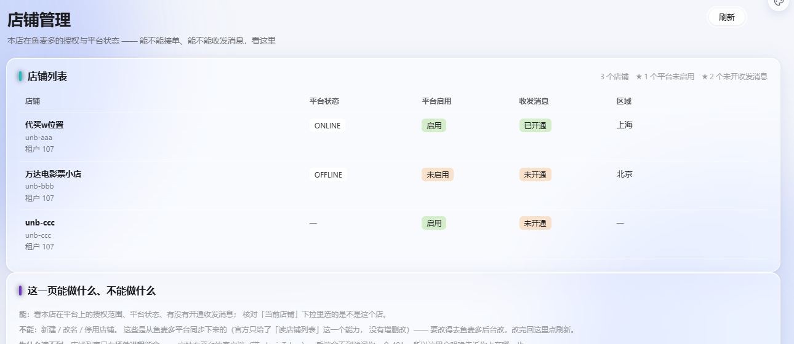
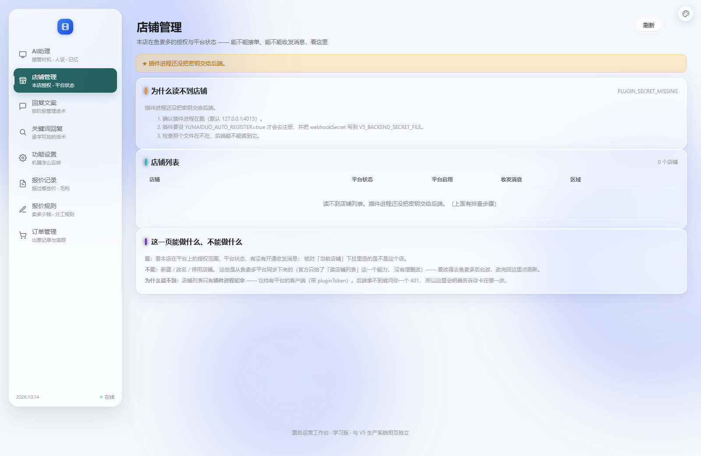

# 补做：店铺管理页

> 日期：2026-10-14
> 店主：「我之前让你加的店铺管理呢」
> **他说得对 —— 我上次只做了一半就交差了。**

---

## 一、我上次做了哪一半（先把账认清楚）

**做了的：**
```
✓ integrations/yumaiduo/shop_client.py   （后端能向插件要店铺列表）
✓ GET /api/shops                          （接口）
✓ web/shops.js                            （填「当前店铺」下拉框）
✓ 把 shops.js 引进了 4 个页面
```

**没做的：**
```
✗ 没有 shops.html —— 一个真正的店铺管理页
✗ 没有 /shops 路由
✗ 侧栏里没有「店铺管理」这一项
```

⇒ 我把"接口 + 一个下拉框"当成了"店铺管理"。
**你要的是一个能看见店铺、能核对状态的页面。**

---

## 二、★ 先确定这一页能做什么（不能做的要说出来）

查了插件侧 `shops.mjs`，官方只给了一个能力：

```js
const rows = await client.shops.list();
```

**只有"读列表"，没有新建 / 改名 / 停用。**
所以我把这一页定位成 **「本店授权与平台状态核对」**，并在页面上
**明确写出"不能做什么"** —— 不假装有增删改按钮。

### 页面回答的问题

```
「我这个店现在能不能接单、能不能收发消息？」
```

| 列 | 来源 | 为什么要看 |
|---|---|---|
| 店铺 | `display_name` / `shop_id` / `tenant_id` | 核对下拉里选的是不是这个店 |
| 平台状态 | `platform_status` | 平台侧在线/离线 |
| 平台启用 | `platform_enabled` | 平台禁用了就接不了单 |
| **收发消息** | `im_enabled` | ★ 见下 |
| 区域 | `area` | 多店时区分 |

### ★★ 为什么把「收发消息」单独一列

```
platform_enabled=true  只表示"平台允许这个店营业"
im_enabled=false       表示【没有开通消息权限】
⇒ 这种状态下：买卖双方的话都传不过来，
  系统再对也没用 —— 它根本收不到消息、也发不出去。

这是个很容易被忽略的组合：平台开着、店铺在线，但消息不通。
所以单独一列，并在摘要里主动点出来。
```

实测摘要（注入 3 个店）：
```
3 个店铺　★ 1 个平台未启用　★ 2 个未开收发消息
```



---

## 三、读不到店铺时怎么办（这一页最实用的部分）

店铺列表**只有插件进程能拿到**（它持有平台的客户端），后端拿不到就问你一个 401。
所以读不到的原因有好几种，**处置完全不同** —— 笼统一句"加载失败"等于没说。

页面按 `error_code` 给出**具体排查步骤**：

| error_code | 原因 | 给出的步骤 |
|---|---|---|
| `PLUGIN_SECRET_MISSING` | 插件还没把密钥交给后端 | 确认插件在跑 → 要设 `YUMAIDUO_AUTO_REGISTER=true` → 检查密钥文件 |
| `PLUGIN_UNREACHABLE` | 连不上插件 | 确认端口；后端读 `YUMAIDUO_PLUGIN_URL`（默认 4015） |
| `PLUGIN_SIGNATURE_REJECTED` | 两边密钥不一致 | 多半是重新注册换了密钥 → 重启后端重读 |
| `SHOP_SCOPE_REQUIRED` | 租户没授权 `account.read` | 去鱼麦多授权页勾上「读取账号/店铺」 |
| `TENANT_ID_MISSING` | 没配租户 id | 设 `YUMAIDUO_TENANT_ID` |

实测（本机就是这样，插件没跑）：
```
code    PLUGIN_SECRET_MISSING
标题    为什么读不到店铺
步骤    确认插件进程在跑（默认 127.0.0.1:4015）。
        插件要设 YUMAIDUO_AUTO_REGISTER=true 才会去注册…
        检查那个文件在不在、后端能不能读到它。
```



---

## 四、改动清单

```
✅ web/shops.html                新增（照现有页面的骨架，不做第二套风格）
✅ web/shops.js                  加页面渲染器；保留下拉框逻辑；
                                 错误码 → 排查步骤表（两边共用同一份解释）
✅ server.py                     "/shops": "/shops.html"
✅ 8 个页面侧栏加「店铺管理」（放第一位，和 V5 一致）
✅ 刷新按钮也用分段控件 UI（和报价记录/订单管理一致）
✅ 12 条断言
```

### ★ 侧栏放第一位的理由

不是为了像 V5，而是它**本来就该第一**：
店铺是"这个系统在为哪个店干活"的前提，别的页面都依赖它。
（V5 也是这么排的，两边一致。）

---

## 五、三个我自己造出来的小坑（都记下来）

```
① index.html 的侧栏项锚点不同
   它带 data-tab="assistant"（AI助理/回复文案 是同一页的两块，
   点击是切面板不是跳页）⇒ 我按"公共前缀"写的锚点找不到它。
   ★ 教训：批量替换的锚点不能取"我以为的公共前缀"，得先看有没有特例。

② shops.html 的「店铺管理」排到了第二位
   那一页的侧栏是我【手写】的，而批量脚本给别的页面插在【最前面】。
   ★ 教训：手写模板 + 批量改混用必然产生不一致；统一成一个来源。

③ 我的提取正则写错了属性顺序
   实际是 class="ticket-nav-item active" href="/shops" aria-current="page"，
   我写成 active" href ⇒ 匹配不上。
   ★ 教训：与其猜正则，不如用 index 定位 + "下一个同类标签"作为边界。
```

上面每一条都被断言抓住了 —— 这正是断言的价值：
**我改的时候出错，但错误没能留在结果里。**

---

## 六、状态

```
✅ 店铺管理页可用（错误态 / 成功态都实测过）
✅ 8 个页面侧栏 8 项、「店铺管理」在第一位、恰好 1 个选中
✅ 12 条断言；33 套自检全过（45.8 秒）｜ _check_orders_ui 172 项
```

**⬜ 一件要你确认的事：**
```
店铺页只读（不能新建/改名/停用）—— 因为官方只给了 shops.list()。
如果你要的「店铺管理」包含"在系统里维护店铺名单"
（比如给每个店配不同的报价规则、备注、别名），
那是【我们自己的数据】，不在平台那边 —— 可以做，但要新增一张表。
要不要做？
```
